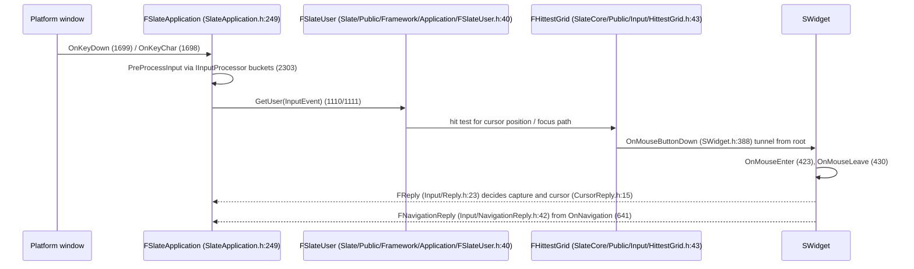

# 10 — Input, Focus, and the Event Model

Input is routed through a per-user focus path and a hit test grid. There is no global "mouse over" — every event is delivered along a `FWidgetPath` (`SlateCore/Public/Layout/WidgetPath.h:50`) built from the window root down to the widget under the cursor.

## Routing

Order facts, from the source comments: pointer input is delivered **tunnel** (root → leaf) at `OnMouseButtonDown` (`SWidget.h:390-391`); `OnMouseEnter`/`OnMouseLeave` are the custom bubble path (`426`). Keyboard input goes to the focus path (`OnKeyDown` `357`).

Pre-processors run before any widget sees input (`RegisterInputPreProcessor` `1544`, `1552`, `1560`, `1568`; bucket type `EInputPreProcessorType` `227`; storage `2308-2314`). `IsProcessingInput()` (`1416`) is the guard used to avoid re-entrancy.

## Focus

| Fact | Anchor |
|---|---|
| Focus is per user | `FSlateUser` (`Slate/Public/Framework/Application/FSlateUser.h:40`), `GetFocusPath` (`136`) |
| Focus entry point | `FSlateApplicationBase::SetKeyboardFocus(path, cause)` pure virtual (`SlateCore/Public/Application/SlateApplicationBase.h:454`); `SlateApplication` `SetKeyboardFocus` (`SlateApplication.h:724`), `SetUserFocus` (`1682-1684`) |
| Widget must opt in | `SupportsKeyboardFocus` (`SWidget.h:929`) |
| Focus queries | `GetFocusedWidget` (`Slate/Private/Framework/Application/SlateUser.cpp:177`), `HasFocus` (`182`), `ShouldShowFocus` (`187`), `HasFocusedDescendants` (`192`), `IsWidgetInFocusPath` (`197`) |
| Capture | `HasAnyCapture` (`212`), `HasCursorCapture` (`217`), `HasCapture(pointerIndex)` (`222`), `DoesWidgetHaveAnyCapture` (`228`); captor paths processed each frame (`SlateApplication.cpp:1557-1560`, `2822-2825`) |
| Focus change context | `SlateCore/Public/Input/Events.h:20` |
| Player mapping | `ULocalPlayer::GetSlateUser()` (`Runtime/Engine/Classes/Engine/LocalPlayer.h:329/330`, impl `LocalPlayer.cpp:1802` → `GetUserFromControllerId`) |

Clearing focus: `ClearUserFocus` / `FSlateUser::ClearFocus` (`SlateUser.cpp:207`). Focusing an invalid widget asserts (`SlateApplication.cpp:2724` `ensureMsgf`) — use clear, not focus-null.

## Navigation

`OnNavigation` (`SWidget.h:641`) returns `FNavigationReply` (`Input/NavigationReply.h:42`). Routing is `FNavigationRouting::RouteNavigationFocus` (`SlateCore/Public/Input/NavigationRouting.h:46`, function `48`) over `FNavigationRoutingParams` (`30`), with per-widget policy `EWidgetNavigationRoutingPolicy` (`15`). The debugger (`Slate/Public/Framework/Navigation/SlateNavigationDebugger.h:48` `FSlateUserNavigationData`, methods `79-94`) listens to the hit test grid (`SetListenToHitTestGrid` `94`) and paints candidate widgets and focus arrows; it is gated by four CVars, all false by default (`Slate/Private/Framework/Navigation/SlateNavigationDebugger.cpp:16,22,28,34`).

Flow direction affects navigation order (`SWidget.h:1242`, `1262`, `1339`, `1349`, `1356-1368`, field `1967`).

## UMG input surfaces

| Surface | Anchor | Notes |
|---|---|---|
| `UWidgetInteractionComponent` | `Runtime/UMG/Public/Components/WidgetInteractionComponent.h:56` | Synthetic pointer/key events; resolves a virtual user (`Private/Components/WidgetInteractionComponent.cpp:493`, `565`) |
| `UGameViewportSubsystem` | `Runtime/UMG/Public/Blueprint/GameViewportSubsystem.h:52` | Per-player viewport UI layers |
| `UWidgetLayoutLibrary` | `Runtime/UMG/Public/Blueprint/WidgetLayoutLibrary.h:48` | Slot add/remove, DPI scale, cursor position |
| `UWidgetComponent` | `Runtime/UMG/Public/Components/WidgetComponent.h` | Hit testing through the `FHittestGrid` owned by `FWidgetRenderer` (`Private/Slate/WidgetRenderer.cpp:121`); user lookup at `Private/Components/WidgetComponent.cpp:1528` |
| Desired focus | `UserWidget.h:1728` `FWidgetChild DesiredFocusWidget` | Set at construction; must be a focus-capable widget |
| Input blocking check | `PlayerController.cpp:5422` `IsWidgetDirectlyUnderCursor` | The standard "is UI under the cursor" test |

## Rules

1. A widget that consumes a key must return `FReply::Handled()`; unhandled replies propagate up the bubble path.
2. Mouse capture is released through the reply, not by clearing a flag (`SlateApplication.cpp:2822-2825` processes `FReply::Handled().ReleaseMouseCapture()`).
3. `SelfHitTestInvisible` containers (`Layout/Visibility.h:26`, flag encoding `103`) receive no pointer events; children still do.
4. Tooltips are per user and can re-enter during modal states (`SlateApplication.cpp:2162` closes tooltips before modal work).
5. Slate can sleep when idle: `Slate.AllowSlateToSleep` defaults to `GIsEditor` (`SlateApplication.cpp:642-644`), `Slate.SleepBufferPostInput` 0.0 (`648-650`), `Slate.ThrottleWhenMouseIsMoving` false (`630-633`), `Slate.TargetFrameRateForResponsiveness` 35 (`636-638`), `Slate.RequireFocusForGamepadInput` false (`654-655`). An idle UI is not a bug; a volatile widget defeats it.