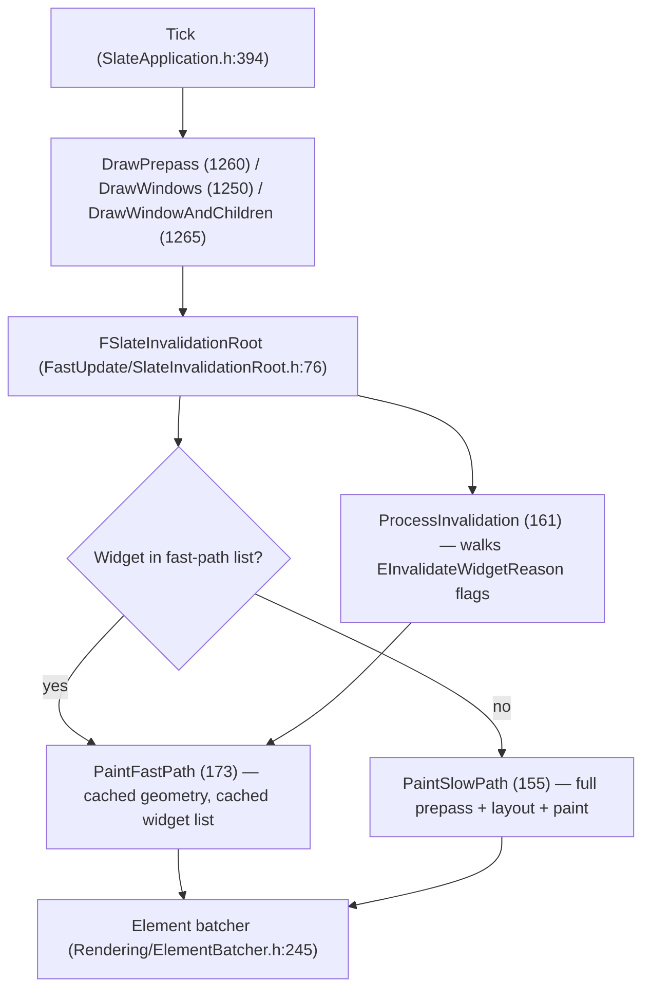

# 11 — Painting, Layout, and Performance

Slate repaints by invalidation, not by frame. A widget is repainted only when something invalidates it, unless it is volatile.

## Cost model

| Cost | Anchor | Notes |
|---|---|---|
| Layout invalidation | `Widgets/InvalidateWidgetReason.h:20` | `Layout = 1 << 0` — source comment calls it "expensive"; do not use when only redraw changed (`18`) |
| Paint-only invalidation | `25` `Paint = 1 << 1` | Cheapest; no prepass |
| Volatility change | `30` `Volatility = 1 << 2` | Recomputes cached volatility (`SWidget.h:1166` note) |
| Child order | `35` `1 << 3` | Implies prepass and layout |
| Render transform | `40` `1 << 4` | |
| Visibility | `45` `1 << 5` | Implies layout |
| Entry point | `SWidget.h:1163` `Invalidate(EInvalidateWidgetReason)` | Called on the widget, resolved through the invalidation root |

Fast-path storage: `Private/FastUpdate/SlateInvalidationWidgetList.h:19`; `BuildFastPathWidgetList` (`SlateInvalidationRoot.h:182`), `ClearAllFastPathData` (`163`). A widget that is not in the list falls to `PaintSlowPath` (`155`).

## Volatility and timers

- `IsVolatile` (`SWidget.h:1135`) forces per-frame paint; `IsVolatileIndirectly` (`1141`) propagates through ancestors. A volatile widget inside an invalidation panel defeats the panel.
- Active timers are the sanctioned per-frame work: `Private/Application/ActiveTimerHandle.h:11` (`FActiveTimerHandle`) is **private** — there is no public handle type, so timers are registered through `SWidget` and cannot be stored by callers.
- UMG: `EWidgetTickFrequency` (`UMG/Public/Blueprint/UserWidget.h:117`, `Never = 0` at `120`), property `1725`, accessor `299`. `Never` means no `NativeTick` (`1586`).
- `UInvalidationBox` → `SInvalidationPanel` (`Slate/Public/Widgets/SInvalidationPanel.h:28`, `SCompoundWidget` + `FSlateInvalidationRoot`); `RebuildWidget` at `UMG/Public/Components/InvalidationBox.h:60`.

## Batching and draw elements

`FSlateWindowElementList` (`Rendering/DrawElements.h:219`) accumulates elements per window; `FSlateDrawElement` (`Rendering/DrawElementTypes.h:45`) is the emission API; the batcher (`Rendering/ElementBatcher.h:245`) merges same-texture runs. Fewer distinct brushes and fonts means fewer batches.

Memory stats: `STATGROUP_SlateMemory` declared at `Rendering/DrawElementCoreTypes.h:28-29`. CSV profiler category: `CSV_DECLARE_CATEGORY_MODULE_EXTERN(SLATECORE_API, Slate)` at `Private/FastUpdate/SlateInvalidationRoot.cpp:20`.

Debug CVars (`SlateInvalidationRoot.cpp`): `Slate.InvalidationRoot.DumpUpdateList` false `25`, `DumpUpdateListOnce` false `33`, deprecated `Slate.DumpUpdateList` `39-43`, `DumpPreInvalidationList` false `45`. Renderer overlays: `Slate.ShowOverdraw` `0` (`SlateRHIRenderer.cpp:149`), `Slate.ShowBatching` `0` (`156`), `Slate.ShowWireFrame` false (`164`).

## Frame throttling

`SlateApplication.cpp`: `Slate.ThrottleWhenMouseIsMoving` false `630-633`; `Slate.TargetFrameRateForResponsiveness` 35 `636-638`; `Slate.AllowSlateToSleep` default `GIsEditor` `642-644`; `Slate.SleepBufferPostInput` 0.0 `648-650`; `Slate.RequireFocusForGamepadInput` false `654-655`. In a game, Slate does not sleep by default — the game loop drives it.

## What actually breaks performance

1. A volatile widget in a large subtree: every frame becomes a slow-path paint for that subtree.
2. Layout invalidation for cosmetic changes (`InvalidateWidgetReason.h:18`) — prepass cost scales with the subtree.
3. Per-frame font lookups: `FSlateFontCache` (`Fonts/FontCache.h:756`) is the atlas provider; changing `FSlateFontInfo` per frame creates new atlas entries.
4. Text layout: `Slate/Private/Widgets/Text/SlateEditableTextLayout.cpp` is the third-most-connected file in the corpus (174 nodes, degree 565) — editable text is not cheap.
5. Attribute binding: `EInvalidateWidgetReason` includes attribute changes (`48` comment); bound attributes re-evaluate per paint.

Graph facts (scoped UI corpus, 35,119 nodes): `Styling/SlateTypes.h` 358 nodes / degree 540, `SlateApplication.cpp` 353 / 1415, `SWidget.cpp` 534 degree. See [README](README.md).
