# 12 — Slate Rendering and Fonts

```mermaid
graph LR
    A["Widget OnPaint (SWidget.h:1771)"] --> B["FSlateWindowElementList (Rendering/DrawElements.h:219)"]
    B --> C["FSlateDrawElement (Rendering/DrawElementTypes.h:45)"]
    C --> D["FSlateElementBatcher (Rendering/ElementBatcher.h:245)"]
    D --> E["FSlateRenderer (Rendering/SlateRenderer.h:24)"]
    E --> F["SlateRHIRenderer (Private/SlateRHIRenderer.cpp)"]
    F --> G["Atlas textures (Fonts/FontCache.h:756, Textures/TextureAtlas.h:335)"]
    G --> H["HDR UI composite / present"]
```

Elements are emitted per window per paint pass, then batched by resource. Batch count is the performance signal (`Slate.ShowBatching`, `SlateRHIRenderer.cpp:156`, gated by `WITH_SLATE_VISUALIZERS` at `146-161`).

## Font path

| Object | Anchor | Role |
|---|---|---|
| `FSlateFontInfo` | `Fonts/SlateFontInfo.h:146` | `USTRUCT(BlueprintType)` with native make; the artist-facing font value |
| `FSlateFontKey` | `Fonts/FontTypes.h:21` | Cache key: font info + outline settings + scale |
| `FSlateFontKeyFuncs` | `71` | Hash-map key functions for the cache |
| `FSlateFontAtlas` | `172` | `ISlateFontTexture` + `FSlateTextureAtlas`; one atlas page per content type |
| `FSlateFontCache` | `Fonts/FontCache.h:756` | `ISlateAtlasProvider` (`Textures/TextureAtlas.h:335`) + `FSlateFlushableAtlasCache` (`290`) — page flushing keeps live atlases small |

Consequences: changing font size or outline settings creates a new cache key (`21`), hence a new atlas page. A per-frame font change is an atlas churn, not a repaint. `FSlateFlushableAtlasCache` (`290`) exists precisely to evict pages, so long-lived UI with many font variants thrashes.

## DPI and scaling

`SDPIScaler` (`Slate/Public/Widgets/Layout/SDPIScaler.h:18`, `SPanel`) applies the DPI scale to its subtree. Layout-level scaling is applied inside `ComputeDesiredSize` (`SWidget.h:774`) via `LayoutScaleMultiplier`. Canvas/HUD text uses `FDisplayDebugManager::GetTextScale()` (`Runtime/Engine/Private/UserInterface/Canvas.cpp:2345`).

## HDR UI compositing (`SlateRHIRenderer.cpp`)

| CVar | Default | Line |
|---|---|---|
| `r.HDR.UI.Level` | 1.0 | `81-85` |
| `r.HDR.UI.Luminance` | 203.0 nits | `87-91` |
| `r.HDR.UI.Luminance.Mode` | 0 (paper white per `r.HDR.PaperWhite.Mode`) | `93-100` |
| `r.HDR.UI.CompositeEOTF` | 0 (gamma) | `102-108` |
| `r.HDR.UI.CompositeEOTF.Gamma` | 2.4 | `110-115` |
| `r.HDR.UI.CompositeBlend` | 0 (gamma) | `117-123` |
| `r.HDR.UI.CompositeBlend.Gamma` | 2.4 | `125-130` |
| `r.HDR.UI.CompositeMode` | 1 (shader pass for HDR blending) | `132-138` |
| `Slate.CopyBackbufferToSlatePostRenderTargets` | 0, experimental | `140-144` |

All are `ECVF_RenderThreadSafe`. UI is composited into the HDR framebuffer with its own EOTF and blend space — UI colors are not treated as scene-linear, which is why a UI color that looks correct in SDR can read wrong on an HDR display.

## Post buffers

Post-buffer blur for UI materials: `Private/Components/PostBufferBlurUpdater.cpp:16` CVar `umg.MaxPostBufferBlurStrength` (default -1 = unlimited); widget surface is `Slate/Public/Widgets/Layout/SBackgroundBlur.h`. Debug build dumps per-frame post buffer updates via `Slate.DumpNumDefaultPostBufferUpdates` (`SlateRHIRenderer.cpp:174-180`, `WITH_SLATE_DEBUGGING`).

## Memory accounting

`STATGROUP_SlateMemory` (`Rendering/DrawElementCoreTypes.h:28-29`). `FSlateWindowElementList` is per-window (`DrawElements.h:219`); the draw buffer (`Rendering/SlateDrawBuffer.h:19`, `FGCObject`) holds them across frames.
