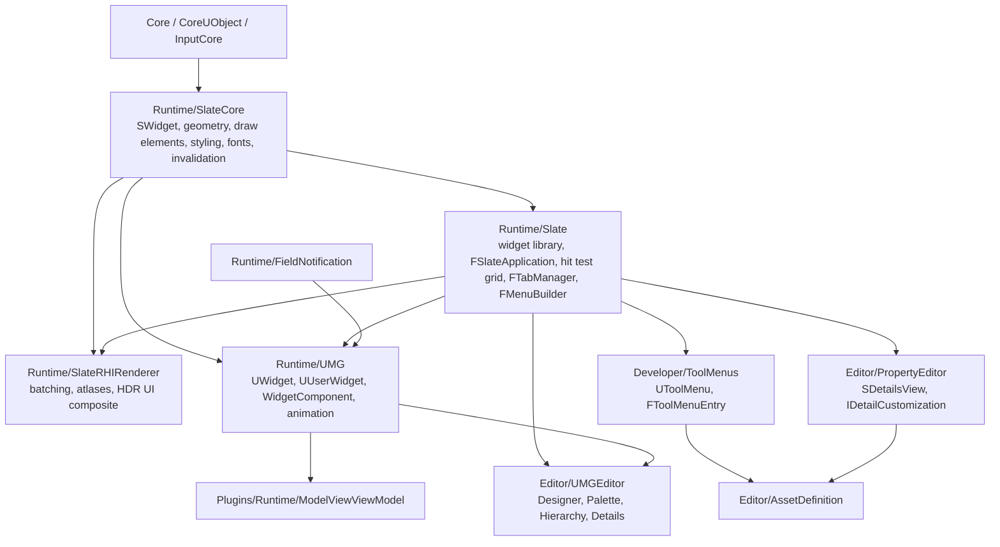
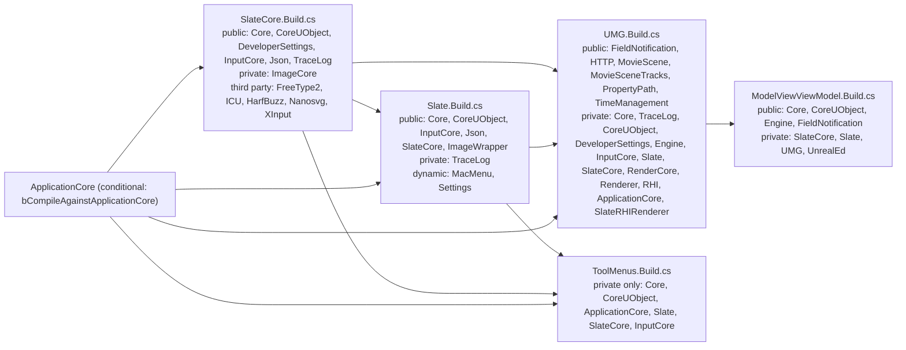

# Unreal 5.8 — User Interface

UE 5.8 UI is a retained-mode Slate renderer with two authoring surfaces (C++ Slate widgets, UMG Widget Blueprints) and three consumers: game HUD, editor tool windows, and standalone applications. There is no immediate-mode UI framework in 5.8 — no ImGui, no Hydra.

**Citation convention.** Every anchor is a direct read of `G:/Epic/UE_5.8/Engine/Source/...` (paths relative to `Engine/Source/` unless a full path is shown). Scout-reported line numbers were treated as untrusted and re-verified; only confirmed anchors appear. Claims that could not be verified are marked `[INFERENCE]`. Graph facts are computed on the scoped corpus described in [13](13_File_Reference.md), not on engine-wide BFS.

## Index

| File | Scope |
|---|---|
| [01](01_Overview_and_Architecture.md) | Layer map, retained-mode contract, what a plugin can hook |
| [02](02_Slate_Core_Architecture.md) | `SWidget` contract, application loop, invalidation root, lifecycle |
| [03](03_Slate_Widget_Catalog_and_Theming.md) | Widget catalog by category, style system, theme/DPI/locale behavior |
| [04](04_UMG_Runtime_Model.md) | `UWidget`/`UUserWidget` bridge, lifecycle, animation, host surfaces, build deps |
| [05](05_MVVM.md) | Plugin layout, viewmodel base, macros, binding data model, subsystems, CVars |
| [06](06_Artist_vs_Programmer_Boundary.md) | Asset-only vs C++-required work, decision path, asymmetries |
| [07](07_Editor_UI_Extension.md) | ToolMenus, tab spawners, detail customizations, asset definitions, settings |
| [08](08_Custom_Tools_and_Widgets.md) | Compound widget recipe, tool windows, standalone app, behavior-changing widgets |
| [09](09_Debug_UI_and_Immediate_Mode.md) | Console, stats, HUD debug text, navigation debugger, immediate-mode pattern |
| [10](10_Input_Focus_and_Event_Model.md) | Routing, focus paths, capture, navigation, UMG input surfaces |
| [11](11_Painting_Layout_and_Performance.md) | Fast/slow path, invalidation reasons, volatility, batching, throttling |
| [12](12_Slate_Rendering_and_Fonts.md) | Element pipeline, font atlas, DPI scaling, HDR UI compositing |
| [13](13_File_Reference.md) | Per-module inventory, corpus node counts, hot files and symbols |
| [14](14_Testing.md) | Actual automation coverage, what is not testable |

## Layers

## `.Build.cs` dependencies

`ToolMenus` depends on Slate privately only — it produces data (`UToolMenu`, `FToolMenuEntry`), and Slate renders it. `UMG` is the only layer that pulls in `Renderer`/`RHI`, which is why a dedicated-server build can drop the UI stack (`Slate.Build.cs:52` `bUsesSlate`, `SlateCore.Build.cs:32` `Target.Type != TargetType.Server` disables FreeType/HarfBuzz).

## Source roots

| Root | Contents |
|---|---|
| `Engine/Source/Runtime/SlateCore` | Model: `Widgets`, `Application`, `FastUpdate`, `Rendering`, `Styling`, `Fonts`, `Textures`, `Input`, `Layout`, `Navigation`, `Debugging`, `Accessibility` |
| `Engine/Source/Runtime/Slate` | `Framework/Application`, `Framework/Docking`, `Framework/MultiBox`, `Widgets` (113 headers) |
| `Engine/Source/Runtime/SlateRHIRenderer` | `Private/SlateRHIRenderer.cpp`, visualizers |
| `Engine/Source/Runtime/UMG` | `Blueprint`, `Components`, `Animation`, `Slate`, `Extensions`, `Binding/States` |
| `Engine/Source/Runtime/FieldNotification` | `FieldNotificationId.h`, `INotifyFieldValueChanged.h` |
| `Engine/Plugins/Runtime/ModelViewViewModel` | 5 modules: Runtime, UncookedOnly, Editor, UncookedOnly, Editor |
| `Engine/Source/Editor/PropertyEditor` | `SDetailsView`, `PropertyHandleImpl`, `PropertyEditorModule` |
| `Engine/Source/Editor/UMGEditor` | Designer, Palette, Hierarchy, Details, Library, Preview, Navigation |
| `Engine/Source/Editor/AssetDefinition` | `UAssetDefinition` |
| `Engine/Source/Editor/LevelEditor` | `FLevelEditorModule`, `ILevelEditor` |
| `Engine/Source/Developer/ToolMenus` | `UToolMenus`, `ToolMenuEntry`, `ToolMenuSection`, `ToolMenuContext` |
| `Engine/Source/Developer/Settings` | `ISettingsModule`, `ISettingsViewer` |
| `Engine/Plugins/Editor/UMGWidgetPreview` | Worked example of an editor tool |

## Graph facts

Scoped corpus: 35,119 nodes (`graphify-out/graph.json`, 2,688,593 nodes / 5,061,968 links total, `built_at_commit bbf056d8568cdd48992ca50f5b36a2b6896930bd`). Only source files are nodes — `.uplugin`, `.Build.cs`, `.uasset`, and Widget Blueprint assets are not graph nodes. Module counts, relation counts, top files, degrees, incoming edges, and hot symbols are in [13](13_File_Reference.md).

Cross-links: rendering pipeline in [../UnrealRenderPipeline/](../UnrealRenderPipeline/), RHI in [../RHI/](../RHI/), RDG in [../RDG/](../RDG/), shaders in [../Shaders/](../Shaders/), NDC in [../NDC/](../NDC/), gameplay systems in [../MASS/](../MASS/) and [../GAS/](../GAS/).
