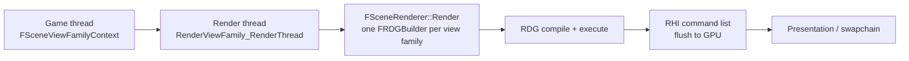

# 01 — Overview and Architecture

The UE 5.8 render pipeline is a per-view-family scheduler built on three layers that each own a distinct contract:

| Layer | Owns | Never owns |
|---|---|---|
| **RHI** (`Engine/Source/Runtime/RHI`) | Command list recording, pipeline state cache, resource states, work graphs, subpasses, feature-level capability flags | Pass ordering, resource lifetime, dependency inference |
| **RenderCore / RDG** (`Engine/Source/Runtime/RenderCore`) | Pass graph, declared access, transitions, transient allocation, execution order, profiling hooks | Scene semantics, subsystem policy |
| **Renderer** (`Engine/Source/Runtime/Renderer`) | Scene state, visibility, subsystem policy, per-frame pass production | Command recording mechanics, resource state legality |

The renderer never records commands directly against a raw `FRHICommandList` for scene work; it registers passes into an `FRDGBuilder` and lets RDG order, transition and submit them. See [../RDG/04_Pass_Model_and_Ordering.md](../RDG/04_Pass_Model_and_Ordering.md) and [../RDG/05_Execution_and_Submission.md](../RDG/05_Execution_and_Submission.md).

## Frame contract

Hard facts of the contract:

- One `FRDGBuilder` per view family. `RenderViewFamily_RenderThread` (`Engine/Source/Runtime/Renderer/Private/SceneRendering.cpp:5215`) is the single render-thread entry: hit proxies (`:5225`), `Renderer->Render(...)` (`:5229`), then `FlushCrossGPUFences` (`:5232`). Everything between is inside the graph.
- `FSceneRenderer::Render` is pure virtual (`SceneRendering.h:2340`); `FDeferredShadingSceneRenderer` overrides it (`DeferredShadingRenderer.h:377`, implementation `DeferredShadingRenderer.cpp:1823`). Forward, mobile and deferred paths are separate implementations of the same contract, not branches inside one function.
- Scene state is read-only on the render thread. Mutations arrive through `FSceneRenderUpdateInputs` (`SceneRendering.h:2841`) built on the game thread.
- Per-view data lives in `FRendererViewDataManager` (`Engine/Source/Runtime/Renderer/Private/ViewData.cpp:6`), which owns view registration (`AllocateViews` `:74`, `RegisterPrimaryView` `:82`, `RegisterView` `:100`) and culling parameters (`GetCullingParameters` `:129`). Subsystems must not cache per-view state outside this manager.
- Cross-GPU work (async compute, copy queues) is only legal inside RDG; `FlushCrossGPUFences` at `:5232` is the last point where the graph may still hold pending work.

## Subsystem inventory

| Subsystem | Entry point | Key types | HLSL dir | Graph nodes |
|---|---|---|---|---|
| Frame orchestration | `SceneRendering.cpp`, `DeferredShadingRenderer.cpp` | `FSceneRenderer`, `FViewInfo` (`SceneRendering.h:1254`), `FViewFamilyInfo` (`:2095`) | — | 11,036 module-root nodes |
| Instance culling / GPUScene | `InstanceCulling/InstanceCullingContext.cpp` | `FInstanceCullingContext`, `FInstanceCullingMergedContext`, `FInstanceCullingManager` | `InstanceCulling/` (7) | 261 |
| Scene culling | `SceneCulling/SceneCulling.cpp` | `FSceneCullingBuilder`, `FSceneCulling`, `THierarchicalSpatialHashGrid` | `SceneCulling/` (3) | 315 |
| Mesh passes | `Public/MeshPassProcessor.h` | `EMeshPass` (`:56`), `FMeshDrawCommand` (`:1281`), `FMeshPassProcessor` (`:2258`) | `Private/MeshPasses` | part of module root |
| Base pass / shading models | `BasePassRendering.cpp`, `ClusteredDeferredShadingPass.cpp` | `FGBufferData` (`DeferredShadingCommon.ush:379`), light grid | `Private/DeferredShading`, `Private/LightMapping` | 191 (`CompositionLighting`) |
| Shadows | `ShadowSetup.cpp`, `VirtualShadowMaps/` | `FShadowMapArray`, `FVirtualShadowMapArray`, `FVirtualShadowMapArrayCacheManager` | `VirtualShadowMaps/` (37) | 187 + 436 |
| Nanite | `Nanite/NaniteCullRaster.cpp`, `NaniteShading.cpp` | `FRenderer`, `FNaniteRasterPipeline`, `FPackedView`, `FRayTracingManager` | `Nanite/` (58) | 1,343 |
| Lumen | `Lumen/LumenScene.cpp`, `LumenScreenProbeGather.cpp`, `LumenReflections.cpp` | `FLumenSceneData`, `FLumenCard`, `FLumenSceneFrameTemporaries` | `Lumen/` (95) | 2,220 |
| MegaLights | `MegaLights/MegaLights.cpp` | `FMegaLightsViewContext` | `MegaLights/` (32) | 541 |
| Ray tracing | `RayTracing/RayTracing.cpp` | `FRayTracingScene`, `FRayTracingShaderBindingTable` | `RayTracing/` (64) | 788 |
| Substrate | `Substrate/Substrate.cpp` | `FSubstrateMaterial`, `FSubstrateTile`, `FGlintShadingLUTsStateData` | `Substrate/` (25) | 172 |
| Post process | `PostProcess/PostProcessing.cpp` | `AddPostProcessingPasses()` (`:412`), `FPostProcessMaterialInputs` (`PostProcessMaterialInputs.h`) | `PostProcessing/` (2), `Bloom/` (11), `ACES/` (8), `SMAA/` (7), `TemporalSuperResolution/` (23) | 1,519 |
| Translucency / volumes | `TranslucentRendering.cpp`, `Froxel/`, `SparseVolumeTexture/`, `HeterogeneousVolumes/` | `FOITSceneData`, `FSortedIndexBuffer`, `FSVTInstance`, voxel grid pipeline | `OIT/` (1), `LocalFogVolumes/` (3) | 102 + 77 + 618 |
| Hair strands | `HairStrands/HairStrandsVisibility.cpp` | `FHairStrandsVisibilityData`, `FHairStrandsTiles` | `HairStrands/` (79) | 915 |
| Virtual texturing | `VT/VirtualTextureSystem.cpp` | `FVirtualTextureSystem`, `FVirtualTexturePhysicalSpace`, `FAdaptiveVirtualTexture` | `VirtualTexture/` | 970 |
| Decals | `DBufferTextures.cpp`, `PostProcess/PostProcessDeferredDecals.cpp` | `FDBufferTextures`, `FDeferredDecalPass` | `Private/Decals` | part of PostProcess |
| Skinning | `Skinning/SkinningSceneExtension.cpp` | transform providers, `FUniformBufferStaticSlot` | `Private/Skinning` | 235 |
| Material cache | `MaterialCache/MaterialCacheRenderer.cpp` | cache scene extension | `MaterialCache/` (9) | 148 |
| Screen space | `SceneTextureReductions.cpp`, `ScreenSpaceRayTracing.cpp`, `ScreenSpaceDenoise/` | `FHZBBuildCS`/`FHZBBuildPS`, denoise framework | `SSRT/` (6), `ScreenSpaceDenoise/` (20) | part of module root |
| Temporal / upscale | `PostProcess/PostProcessTemporalAA.cpp`, `PostProcessTemporalSuperResolution.cpp`, `Public/TemporalUpscaler.h` | `ISpatialUpscaler` | `TemporalSuperResolution/` (23) | part of PostProcess |
| VRS / scaling | `VariableRateShading/`, `RenderCore/Public/DynamicRenderScaling.h` | `IVariableRateShadingImageManager` | `Private/VariableRateShading` | 78 |
| State stream | `StateStream/` | replayable frame state | — | 154 |

## Design constraints that shape every chapter

1. **Recording is single-threaded per command list.** Pass lambdas run on the render thread (or the RHI thread); anything a pass lambda reads must already be resolved by RDG. Parallelism exists at the task-graph level for culling and setup, not inside a pass.
2. **Pipeline state is cached per thread.** `PipelineStateCache.cpp:1726-1735` keeps TLS caches per thread and consolidates them (`:2231`, `:2269`) with separate render-thread and RHI-thread maps (`:2434-2450`). A shader permutation that is only ever referenced from one thread cannot be looked up from another.
3. **Render-pass merge and async compute are mutually exclusive.** `RenderGraphPrivate.h:224` and `:229`; the async path additionally requires `!IsImmediateMode()`, `GSupportsEfficientAsyncCompute` and separate-queue support (`:233`). A subsystem that assumes tile-based deferred shading (subpasses) silently loses async compute overlap.
4. **Capability gates are data-driven, not runtime guesses.** Ray tracing must be checked through `IsRayTracingEnabled()` — the header states that platform info alone is insufficient and `GRHISupportsRayTracing` plus `r.RayTracing` must also be checked (`DataDrivenShaderPlatformInfo.h:1204-1230`).
5. **Shader parameters are generated, not hand-marshalled.** `IMPLEMENT_GLOBAL_SHADER_PARAMETER_STRUCT` (`ShaderParameterMacros.h:1601`) and `SHADER_PARAMETER_STRUCT_REF` (`:1854`) produce the C++ struct and the matching HLSL cbuffer from the same declaration; a mismatch between the two is a compile-time failure, not a runtime one.
6. **Compute dispatch geometry is validated.** `kGolden2DGroupSize = 8` (`RenderGraphUtils.h:336`), `WrappedGroupStride = 128` (`:380`) which must match `WRAPPED_GROUP_STRIDE` in `ComputeShaderUtils.ush` (`:378`), and `check` against `GRHIMaxDispatchThreadGroupsPerDimension` (`:390`). Details in [12_Compute_Shader_Infrastructure.md](12_Compute_Shader_Infrastructure.md).
7. **Profiling is graph-scoped.** `STATGROUP_RDG` is declared at `Core/Public/Stats/GlobalStats.inl:62` (RHI at `:61`), and the RDG counters (`RenderGraphPrivate.h:164-190`) are the only place pass counts, transitions and batches are visible.

## What a tech artist must know

- The pipeline is a graph, not a list. Changing a subsystem's order is done by changing which pass it registers and what it reads, not by moving code lines.
- Every subsystem has a visualizer that reads its own intermediate data (`VisualizeTexture`, Lumen visualizers, MegaLights light complexity, Nanite visualizers, Substrate visualizers). Those are the fastest path to understanding what a knob actually changes — see [18_Tech_Artist_Guide.md](18_Tech_Artist_Guide.md).
- Feature-level gates are per-platform. A material, a shading model or a subsystem can be present in the editor and absent at runtime on the target platform; the graph facts above show which subsystems are gated by RHI capability flags rather than by show flags.

## Graph facts for this chapter

- Renderer module: 22,449 nodes; RenderCore 7,571; RHI 5,286; Engine 109,367.
- Renderer → RHI direct edges: 1,070. Renderer → RenderCore: 4,633. Renderer → Core: 4,137. Incoming: Developer 1,320, Editor 1,407, Engine 1,076.
- Highest-degree Renderer files: `PostProcess/PostProcessGBufferHints.cpp` 14,890, `ScenePrivate.h` 2,737, `SceneRendering.h` 1,977, `RendererScene.cpp` 1,433, `Public/MeshPassProcessor.h` 1,230, `Nanite/NaniteShared.h` 1,197, `ShadowSetup.cpp` 1,193, `Lumen/LumenSceneData.h` 1,124, `SceneRendering.cpp` 973, `DeferredShadingRenderer.h` 946.
- Renderer communities: 18 "Scene View and Materials" 2,112 nodes; 37 2,071; 6 "Render Graph (RDG)" 1,483; 33 1,360; 60 894; 156 797; 178 643.
- `FDeferredShadingSceneRenderer::Render` reaches `FRDGBuilder` in 4 hops through `RenderUtils.cpp` helpers (`IsForwardShadingEnabled()` `RenderUtils.cpp:1680` → `ShouldForceFullDepthPass()` `:681` → `FRDGBuilder` `RenderGraphBuilder.h:50`) — the renderer calls RDG utilities, not the builder's internals.
