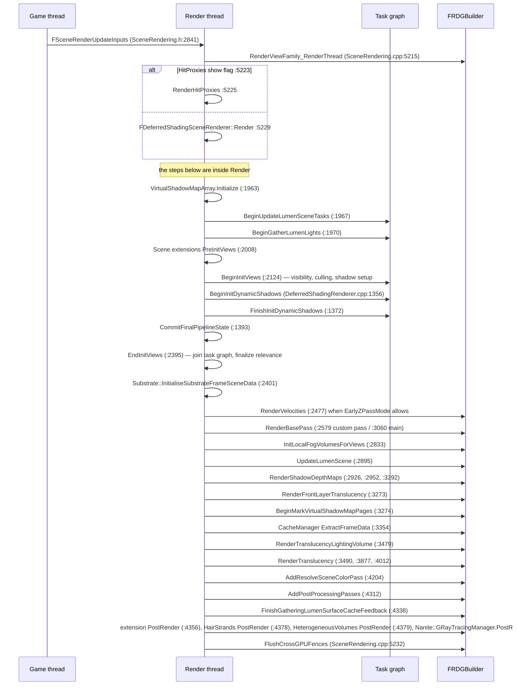

# 02 — Frame Flow and Scene View

## Entry path

Game thread builds a `FSceneViewFamilyContext` (`Engine/Source/Runtime/Engine/Public/SceneView.h:2777`, base class `FSceneViewFamily` at `:2320`) from `FSceneViewInitOptions` (`:180`). The render thread then runs exactly one function per frame per view family:

```
RenderViewFamily_RenderThread(FRDGBuilder&, FSceneRenderer*, const FSceneRenderUpdateInputs*)
  Engine/Source/Runtime/Renderer/Private/SceneRendering.cpp:5215
    :5225  Renderer->RenderHitProxies(...)      // only when hit proxies are enabled
    :5229  Renderer->Render(...)                // the pipeline — else branch of :5223, not both
    :5232  Renderer->FlushCrossGPUFences(...)   // last graph activity
```

`FSceneRenderer::Render` is pure virtual (`SceneRendering.h:2340`); the deferred implementation is `FDeferredShadingSceneRenderer::Render` (`DeferredShadingRenderer.h:377`, body `DeferredShadingRenderer.cpp:1823`). Forward (`ForwardShadingRenderer.*`) and mobile (`MobileShadingRenderer.*`) implement the same interface with different stage sets.

Key view types:

| Type | Definition | Role |
|---|---|---|
| `FSceneView` | `Engine/Public/SceneView.h:1481` | camera, projection, view flags, post-process state |
| `FSceneViewFamily` | `Engine/Public/SceneView.h:2320` | group of views sharing one frame, screen percentage, upscaler, extensions |
| `FViewInfo` | `Renderer/Private/SceneRendering.h:1254` | render-thread view: shader parameter data, relevance, texture references |
| `FViewFamilyInfo` | `Renderer/Private/SceneRendering.h:2095` | render-thread family: owns per-frame view state and view data manager |
| `FSceneViewState` | `Renderer/Private/SceneViewState.h:59` | cross-frame history: TAA history, Lumen state, VSM cache keys, upscaler state |
| `FSceneRenderUpdateInputs` | `Renderer/Private/SceneRendering.h:2841` | game-thread → render-thread handoff |

`FSceneViewState` is the only object that survives frames. Anything a subsystem needs between frames (temporal history, surface cache, page cache) hangs off it or off `FScene`, never off `FViewInfo`.

## Per-view data manager

`FRendererViewDataManager` (`Renderer/Private/ViewData.cpp:6`) is the single owner of per-view shader parameters:

- `InitInstanceState` (`:50`) — allocates the instance/state buffers used by GPUScene.
- `AllocateViews` (`:74`), `RegisterPrimaryView` (`:82`), `RegisterView(const Nanite::FPackedViewParams&)` (`:100`), `FlushRegisteredViews` (`:113`) — views are registered once and then referenced by index, which is what lets Nanite, Lumen and MegaLights shaders address a view by index in a compute pass.
- `GetCullingParameters` (`:129`) — the culling parameter struct handed to the instance-culling dispatch.

Consequence: a subsystem that wants per-view data in a compute shader must go through this manager (view index + parameter struct), not read `FViewInfo` fields directly inside a pass lambda that runs after views have been flushed.

## Scene extensions

Extensions are the mechanism for per-scene persistent state plus per-frame render hooks. Interfaces (`Renderer/Private/SceneExtensions.h`):

| Interface | Line | Contract |
|---|---|---|
| `ISceneExtension` | `:23` | persistent per-scene data; `ShouldCreateExtension` gates creation |
| `ISceneExtensionUpdater` | `:44` | game-thread → render-thread data sync: `Begin` `:49`, `End` `:50`, `PostLightsUpdate` `:55`, `PreLightsUpdate` `:56`, `PreSceneUpdate` `:61`, `PostSceneUpdate` `:63`, `PostGPUSceneUpdate` `:64` |
| `ISceneExtensionRenderer` | `:68` | per-frame render hooks; constructed per renderer |
| `ISceneExtensionFactory` | `:117` | `CreateInstance(FScene&)` |
| `FSceneExtensionRegistry` | `:132` | global factory list; `Get()` lazily initializes (`SceneExtensions.cpp:11,13-15`) |

Hooks available to an extension renderer: `PreInitViews` (`SceneExtensions.h:88`), `PreRender` (`:102`), `PostRender` (`:107`). Registration is static-initializer based: `DECLARE_SCENE_EXTENSION` (`:403`), `IMPLEMENT_SCENE_EXTENSION` (`:418`) instantiates `TSceneExtensionRegistration` whose constructor calls `FSceneExtensionRegistry::Get().Register(*this)` (`:385-388`). Extension IDs are assigned by registration order (`GetMaxRegistrationID()` `:141`), so **the set of extensions and their IDs depend on link order** — a plugin that registers an extension changes IDs for everything after it. `[INFERENCE: order-dependent IDs are observable through `GetExtensionID()`, which is why cross-module code must look up by ID at runtime rather than hard-code it.]`

Registered extensions in the Renderer module (file:line of `IMPLEMENT_SCENE_EXTENSION`):

| Extension | Line |
|---|---|
| `FFirstPersonSceneExtension` | `FirstPersonSceneExtension.cpp:8` |
| `FLightGridSceneExtension` | `LightGridInjection.cpp:347` |
| `FSplineMeshSceneExtension` | `SplineMeshSceneResources.cpp:134` |
| `FRenderCurveSceneExtension` | `HairStrands/RenderCurveSceneExtension.cpp:15` |
| `FMaterialCacheSceneExtension` | `MaterialCache/MaterialCacheSceneExtension.cpp:16` |
| `FEditorSceneExtension` | `Nanite/NaniteEditor.cpp:454` |
| `FMaterialsSceneExtension` | `Nanite/NaniteMaterialsSceneExtension.cpp:82` |
| `FOwnershipVisibilitySceneExtension` | `Nanite/NaniteOwnershipVisibilitySceneExtension.cpp:32` |
| `FSceneCulling` | `SceneCulling/SceneCulling.cpp:280` |
| `FCSMSceneExtension` | `Shadows/CSMSceneExtension.cpp:7` |
| `FShadowScene` | `Shadows/ShadowScene.cpp:44` |
| `FVirtualShadowMapArrayCacheManager` | `VirtualShadowMaps/VirtualShadowMapCacheManager.cpp:645` |
| `FAnimBankTransformProvider` | `Skinning/AnimBankTransformProvider.cpp:28` |
| `FAnimRuntimeTransformProvider` | `Skinning/AnimRuntimeTransformProvider.cpp:6` |
| `FAnimSequenceTransformProvider` | `Skinning/AnimSequenceTransformProvider.cpp:29` |
| `FSkinningSceneExtension` | `Skinning/SkinningSceneExtension.cpp:236` |
| `FSkinningTransformProvider` | `Skinning/SkinningTransformProvider.cpp:9` |
| `FMeshPaintVirtualTextureSceneExtension` | `VT/MeshPaintVirtualTextureSceneExtension.cpp:11` |
| `FRuntimeVirtualTextureSceneExtension` | `VT/RuntimeVirtualTextureSceneExtension.cpp:8` |

Per-renderer renderer objects are created from the extension list at `SceneExtensions.cpp:77-84` (`CreateRenderers`), updaters at `:63-70`, and the extension instances themselves at `:25-47`.

## Frame skeleton



## Why the frame is split into Begin/End halves

`BeginInitViews` (`:2124`) and `EndInitViews` (`:2395`) exist so the task graph can run visibility, instance culling, shadow setup and Lumen light gathering concurrently. The join happens at `EndInitViews`; anything that needs completed view relevance must run after it — the source states this explicitly before the Substrate call (`:2399` "Need to run after EndInitViews() to ensure ViewRelevance computation are completed").

`CriticalPathStall.AfterInitViews` (`:1388`-`:1391`) is the diagnostic knob. It is applied at `:2128`-`:2132` under `#if !UE_BUILD_SHIPPING` (`:2127`) with `SCOPE_CYCLE_COUNTER(STAT_InitViews_Intentional_Stall)` (`:2130`) — the sleep happens on the render thread immediately after `BeginInitViews` dispatch (`:2124`), inside the `VisibilityCommands` event scope (`:2123`), not after `EndInitViews` despite the name. It forces a change in the critical path (`:1391`), which is what makes overlapped work visible in a profile.

`CommitFinalPipelineState` (`:1393`) is the point where the pipeline state cache is finalized for the frame; passes registered before it can still change pipeline state, after it cannot. See [../RHI/](../RHI/) for the cache mechanics.

## Asserts that catch authoring mistakes

- `check(IsRayTracingEnabled() && !Views.IsEmpty())` — `DeferredShadingRenderer.cpp:1092`: ray-traced paths require a non-empty view list and an enabled platform.
- `check(!UseNanite(ShaderPlatform) || bNeedsPrePass)` — `:2361`: Nanite with no depth prepass is not a supported combination in this path.
- `check(Views.Num() == NaniteRasterResults.Num())` — `:3211`: raster results are indexed per view; a view-count mismatch is a hard failure.
- `ensureMsgf` warnings for Virtual Shadow Maps in forward shading (`:2925`, `:2949`) — VSM is not supported in the forward path.

## Tech artist notes

- Screen percentage, upscaler and TAA history are view-family properties, not view properties. A per-view override that changes resolution changes the family's history key and can invalidate `FSceneViewState` state for that view.
- A scene extension that is not registered is not "disabled" — it does not exist for that scene. `ShouldCreateExtension` is evaluated at scene creation, so toggling it requires a scene rebuild.
- Post-render hooks (`PostRender` at `:4356`) run inside the graph, so an extension can still add passes; anything added after `AddPostProcessingPasses` (`:4312`) lands after tonemapping and is visible in the final image.

## Graph facts

- Renderer module root files (the frame-flow layer, not in a subsystem directory) contribute 11,036 nodes; `ScenePrivate.h` 2,737 degree, `SceneRendering.h` 1,977, `RendererScene.cpp` 1,433, `SceneRendering.cpp` 973, `DeferredShadingRenderer.h` 946.
- Community 18 "Scene View and Materials" is the largest render community at 2,112 nodes; community 37 (2,071) and community 6 "Render Graph (RDG)" (1,483) follow.
- Scene extension hub: `FSceneCulling` 84 degree, `FSceneCullingBuilder` 85, `FVirtualShadowMapArrayCacheManager` 81, `FSkinningSceneExtension` and `FMaterialCacheSceneExtension` appear through their updater/renderer classes.
- `FInstanceCullingContext` reaches `FRDGBuilder` in 3 hops through `PlatformGPUSceneUsesUniformBufferView()` (`RenderUtils.cpp:496`), confirming that culling is bound to RDG through RenderCore helpers rather than direct builder calls.
