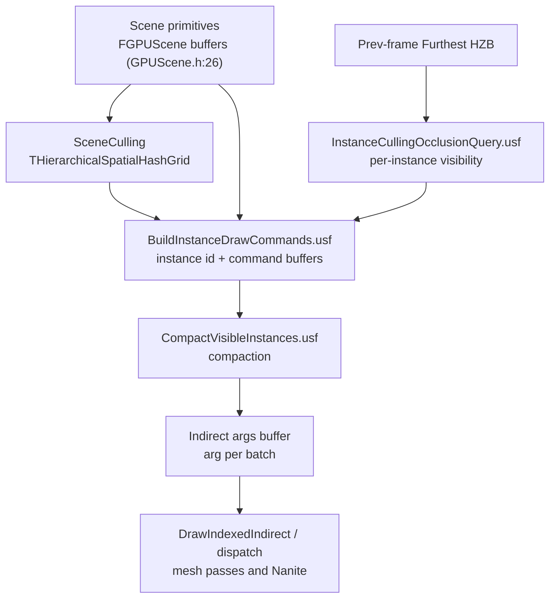

# 03 — Instance Culling and GPUScene

## What the stage decides

Two independent questions, resolved by two functions:

| Question | Answered by | Source |
|---|---|---|
| Do we cull instances on the GPU at all? | `FInstanceCullingContext::IsGPUCullingEnabled()` → `CVarCullInstances.GetValueOnAnyThread() != 0` | `Renderer/Private/InstanceCulling/InstanceCullingContext.cpp:211-213` (`r.CullInstances`, declared `:28`, default 1) |
| Do we use HZB-based per-instance occlusion culling? | `IsOcclusionCullingEnabled()` → `IsGPUCullingEnabled() && CVarOcclusionCullInstances != 0` | `:216-218` (`r.InstanceCulling.OcclusionCull`, declared `:34`) |

If GPU culling is off, the renderer falls back to CPU visibility and per-draw command submission; the GPUScene buffers still exist but the indirect path is not used. If occlusion culling is on, it is **one frame late** — it reads the previous frame's HZB (`PrevHZB.IsValid()` at `:853`), so newly appearing geometry is never occluded-culled in its first frame.

## Types

| Type | Definition | Role |
|---|---|---|
| `FInstanceCullingContext` | `Renderer/Public/InstanceCulling/InstanceCullingContext.h:75` | per-view culling state: instance id buffer, indirect args, permutation flags |
| `FInstanceCullingMergedContext` | same header | multi-view merged culling (one dispatch for all views) |
| `FUniformBufferStaticSlot` | `:95` (`GetStaticUniformBufferSlot`), used at `:350` | static slot holding the GPUScene uniform buffer; the mechanism that lets shaders address GPUScene without a per-pass UB |
| `FInstanceCullingManager` | `Renderer/Private/InstanceCulling/` | owns the merged context and dispatches the culling passes |
| `FInstanceCullingLoadBalancerBase` | `Renderer/Private/InstanceCulling/InstanceCullingLoadBalancer.h:19` | batch/item distribution across thread groups |
| `FInstanceCullingOcclusionQueryRenderer` | `Renderer/Private/InstanceCulling/InstanceCullingOcclusionQuery.h:20` | HZB + software occlusion query evaluation per instance |
| `FGPUScene` | `Renderer/Private/GPUScene.h:26` | persistent instance/primitive data buffers |

GPUScene shader parameter structs (`GPUScene.h`): `FGPUSceneCommonParameters` (`:47-52`, SOA stride, frame number, max allocated instance id, max persistent primitive index), `FGPUSceneResourceParameters` with RDG SRVs (`:56-63`), and the RHI variant for non-graph paths (`:66-73`). The RDG variant is what subsystems inside the graph must use; the RHI variant exists for paths that record outside RDG.

## Data flow



Shader files: `Engine/Shaders/Private/InstanceCulling/` — `BuildInstanceDrawCommands.usf`, `CompactVisibleInstances.usf`, `InstanceCompactionCommon.ush`, `InstanceCullingCommon.ush`, `InstanceCullingLoadBalancer.ush`, `InstanceCullingOcclusionQuery.usf`, `InstanceCullingSetup.ush`. `Engine/Shaders/Private/GPUScene/` — `GPUSceneDataManagement.usf`, `GPUSceneWriter.ush`. `Engine/Shaders/Private/SceneCulling/` — `SceneCulling.ush`, `SceneCullingBuildExplicitBounds.usf`, `SceneCullingDebugRender.usf`.

## Pass structure

The culling passes are permutation-driven compute passes. The permutation domain (`InstanceCullingContext.cpp:501-509`) is:

```
TShaderPermutationDomain<FSingleInstanceModeDim, FCullInstancesDim, FAllowWPODisableDim, FOcclusionCullInstancesDim, FStereoModeDim, FBatchedDim, FInstanceCompactionDim>
```

so the same shader source compiles to distinct variants depending on whether culling and occlusion culling are active. The occlusion flag is set at `:892` (single-view path) and `:1250` (merged path), gated by `PrevHZB.IsValid() && IsOcclusionCullingEnabled()` (`:853`, `:1236`).

Dispatch sites: `:899`, `:923`, `:946` (single-view path), `:1255`, `:1285`, `:1310` (merged path), `:1408`/`:1427` (setup/indirect). The `bCullInstances` decision is read on the render thread at `:749` and `:1081`.

## Load balancer

`FInstanceCullingLoadBalancerBase` (`InstanceCullingLoadBalancer.h:19`) packs work as batches of items and exposes the shader parameters (`:67-73`): `BatchBuffer`, `ItemBuffer`, `NumBatches`, `NumItems`, `NumGroupsPerBatch`. Dispatch uses the wrapped group count (`:104`, `:107`, `:212-218`), which is `GetGroupCountWrapped(NumBatches)` — a 3D group count that encodes a linear batch index because the RHI limits each dispatch dimension to `WrappedGroupStride = 128` (`RenderCore/Public/RenderGraphUtils.h:380`). The shader recovers the linear index with `GetUnWrappedDispatchGroupId` (`Engine/Shaders/Private/InstanceCulling/InstanceCullingLoadBalancer.ush:168`); the header comment at `:213` is what tells the shader to do that, and `:378` states the C++ constant must match `WRAPPED_GROUP_STRIDE` in `ComputeShaderUtils.ush`.

Consequence: a load-balanced pass cannot be dispatched with a naive `ceil(items / threads)` group count; the wrapped encoding is mandatory, and the C++ and HLSL constants must agree (`RenderGraphUtils.h:378`).

## Occlusion query invariants

`InstanceCullingOcclusionQuery.cpp` asserts the conditions the shader relies on:

- `check(!VisibleMeshDrawCommand.PrimitiveIdInfo.bIsDynamicPrimitive)` (`:329`) — occlusion culling is only valid for static GPUScene primitives.
- `ensureMsgf(NumThreadGroups.X * NumThreadsPerGroup <= MaxSupportedInstances, ...)` (`:388`) — the group count must not exceed the allocated result slots.
- Buffers are aligned so every thread has a valid write slot without bounds checks (`:397`), and `check(AlignedNumInstances != 0)` (`:434`).
- `check(InstanceBaseIndex + CommandNumInstances <= uint32(NumGPUSceneInstances))` (`:459`) — command ranges must stay inside GPUScene.
- `check(ResultCursor == ResultData + AlignedNumInstances)` (`:474`) — every slot must be written exactly once.
- `checkf(DepthTexture && IsHZBValid(View, EHZBType::FurthestHZB), ...)` (`:587`, `:930`) — occlusion culling requires a **furthest** HZB, not the closest one used for depth culling.
- `checkf(uint32(NumGPUSceneInstances) == AllocatedNumInstances, ...)` (`:617`) — GPUScene instance count must not change during the frame. This is the reason instance additions are batched at frame boundaries.
- `check(Index >= 0 && Index < MaxViews)` (`:799`) — per-view result slots are fixed-size.

The CVar `r.InstanceCulling.OcclusionQueries` (`:27`) and the load-balancer ref (`:34`) control the path; the pass is skipped when either is off (`:816`).

## Design constraints

1. **One-frame latency.** Occlusion results come from the previous frame's HZB, so the pipeline must accept false negatives. Geometry that just entered the view is drawn; geometry that just left may be culled incorrectly for one frame.
2. **Static-primitive only.** Dynamic primitives (skeletal meshes with dynamic GPUScene entries) are excluded by `:329`.
3. **Fixed-size result buffers.** Alignment to thread-group size (`:397`) trades memory for branch-free shaders.
4. **Indirect args must be validated.** `RenderGraphUtils.h:428` (`checkf` offset % 4) and `:441` (buffer must be Vertex/ByteAddress type with `BUF_DrawIndirect`) — a culling pass that writes indirect args through the wrong buffer type fails at graph build time, not on the GPU.
5. **GPUScene is a shared resource.** Every subsystem that draws (Nanite, mesh passes, ray tracing, hair, decals reading VT) reads the same instance buffers through the static slot; a subsystem that mutates them must do so through `FGPUScene` writers (`GPUSceneDataManagement.usf`), not ad hoc.

## Tech artist notes

- `r.CullInstances 0` is the only reliable way to test whether a culling bug is in the GPU path; it changes the draw path entirely, so profiling before/after is not comparable.
- Occlusion culling interacts with the depth prepass: without a furthest HZB the pass is skipped (`:587`, `:930`), so disabling the prepass silently disables per-instance occlusion culling.
- Instance counts that change mid-frame trip `:617`; streaming or level-of-switching that adds instances during the frame is the usual cause.

## Graph facts

- InstanceCulling subsystem: 261 nodes; SceneCulling 315.
- Top symbols: `FInstanceCullingContext` 104, `FInstanceCullingMergedContext` 45, `FUniformBufferStaticSlot` 31, `FInstanceCullingOcclusionQueryDeferredContext` 31, `FInstanceCullingManager` 29, `FSceneCullingBuilder` 85, `FSceneCulling` 84, `THierarchicalSpatialHashGrid` 38, `FSceneInstanceCullingQuery` 22.
- `FInstanceCullingContext` reaches `FRDGBuilder` in 3 hops through `PlatformGPUSceneUsesUniformBufferView()` (`RenderCore/Private/RenderUtils.cpp:496`) — the static slot decision is a RenderCore policy, not a Renderer policy.
- Shader files in this subsystem are not graph nodes; the counts above are C++ only.
