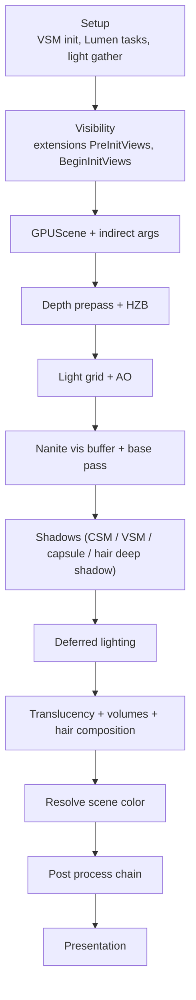

# 05 — Pass Catalog and Frame Order

The order below is the order in which passes are **registered** in `FDeferredShadingSceneRenderer::Render` (`Engine/Source/Runtime/Renderer/Private/DeferredShadingRenderer.cpp:1823`). RDG may reorder independent passes; the registered order is what determines the dependency graph and what appears in RenderGraphInsights.

## Frame order

| # | Stage | Registration site | Event scope |
|---|---|---|---|
| 1 | Virtual Shadow Map init | `:1963` | — |
| 2 | Lumen scene update tasks | `:1967` | — |
| 3 | Lumen light gather | `:1970` | — |
| 4 | Scene extension `PreInitViews` | `:2008` | — |
| 5 | Visibility / view init | `:2124` | `VisibilityCommands` (`:2123`), `Scene` (`:2079`) |
| 6 | GPUScene update | `:2236` | `GPUSceneUpdate` |
| 7 | Dynamic shadow setup | `:1356` / `:1372` | — |
| 8 | Pipeline state commit | `:1393` | — |
| 9 | `EndInitViews` (task join) | `:2395` | — |
| 10 | Substrate frame scene data | `:2401` | `Substrate` (`:3171`) |
| 11 | Custom render passes | `:2515` | `CustomRenderPasses` (`:2515`), per-pass `CustomRenderPass[i] <name>` (`:2543`) |
| 12 | Velocity (opaque) | `:2477` | — |
| 13 | HZB build | `:561` (`RenderHzb`) | `HZB` (`:563`), `BuildHZB(ViewId=N)` (`:577`) |
| 14 | Light grid / composition lighting | `:2720` (`ComputeLightGridOutput`) | `CompositionBeforeBasePass` (`CompositionLighting/CompositionLighting.cpp:557`), `LightCompositionTasks_PreLighting` (`:611`) |
| 15 | SSAO / GTAO | `CompositionLighting/CompositionLighting.cpp:537` config | `SSAOSetup` (`CompositionLighting/PostProcessAmbientOcclusion.cpp:553`), `SSAO` (`:903`), `GTAO HorizonSearch` (`:1436`), `GTAO InnerIntegrate` (`:1340`), `GTAO Spatial Filter` (`:1655`), `GTAO Upsample` (`:1758`) |
| 16 | Depth prepass | `DepthRendering.cpp:525` | `PrePass <mode> <reason>` (`:525`), `DitheredStencilPrePass` (`:299`) |
| 17 | Nanite prime HZB | `:1669` | `Nanite::PrimeHZB` |
| 18 | Nanite visibility buffer | `:1533`, `:1762` | `Nanite::VisBuffer` |
| 19 | Nanite base pass | `:1789` | `NaniteBasePass` (`:1789`, `BasePassRendering.cpp:1404`) |
| 20 | Base pass (non-Nanite) | `:3060` | `BasePass` (`BasePassRendering.cpp:1452`), `ClearGBufferAtMaxZ` (`:779`) |
| 21 | Anisotropy pass | `AnisotropyRendering.cpp:368` | `RenderAnisotropyPass` |
| 22 | Local fog volumes | `:2833` | `Fog::RenderSeparateCompositionTextures` (`:3759`), `Fog::UpsampleFogSeparateCompositionTexture` (`:3797`) |
| 23 | Lumen scene update | `:2895` | — |
| 24 | Shadow depth maps | `:2926`, `:2952`, `:3292` | — |
| 25 | Capsule shadows | `CapsuleShadowRendering.cpp:503`, `:994`, `:1021`, `:1216` | `CapsuleShadows`, `IndirectCapsuleShadows` |
| 26 | Hair visibility / voxelization | `HairStrandsVisibility.cpp:4757` | `HairStrandsVisibility` |
| 27 | Hair voxel pages | `HairStrandsVoxelization.cpp:838`, `:1022`, `:1088`, `:1212` | `HairStrandsVoxelPageAllocation`, `HairStrandsIndVoxelPageClear`, `HairStrandsVoxelize`, `HairStrandsDensityMipGen` |
| 28 | Hair deep shadow / transmittance | `HairStrandsDeepShadow.cpp:226`, `HairStrandsTransmittance.cpp:787`, `:947` | `HairStrandsDeepShadow`, `HairStrands::TransmittanceMask`, `HairStrands::OpaqueShadowMask` |
| 29 | Front-layer translucency | `:3273` | `FrontLayerTranslucency` (`:3494`), `FrontLayerTranslucencyGBuffer` (`FrontLayerTranslucency.cpp:704`) |
| 30 | VSM page marking / extraction | `:3274`, `:3354` | — |
| 31 | Deferred lighting (stochastic) | `:3202` | `StochasticLighting` (`:3202`) |
| 32 | Deferred lighting (clustered) | `:3421`, `:3512` | `RenderDeferredLighting`, `ClusteredShading` (`ClusteredDeferredShadingPass.cpp:345`) |
| 33 | Translucency lighting volume | `:3479` | — |
| 34 | Translucency | `:3490`, `:3877`, `:4012` | `Translucency` (`:3970`) |
| 35 | Translucent velocity | `:3643`, `:3650`, `:4033`, `:4041` | `EarlyTranslucencyVelocity` (`:3624`) |
| 36 | Hair rendering (composition) | `:3934`, `:4019`, `:4053` | `HairRendering`, `HairStrandsComposition` (`HairStrandsComposition.cpp:698`) |
| 37 | Heterogeneous volumes | `HeterogeneousVolumes.cpp:1090` | `HeterogeneousVolumes`, `HeterogeneousVolumeShadows` (`:965`, `:990`) |
| 38 | Distortion / rough refraction | `DistortionRendering.cpp:564` | `Distortion`, `Rough Refraction View N` (`:593`) |
| 39 | Fog | `FogRendering.cpp:649`, `:696`, `:901` | `ExponentialHeightFog`, `ExponentialHeightFog on Clouds`, `SLW::ExponentialHeightFog` |
| 40 | Custom depth | `CustomDepthRendering.cpp:290`, `:332` | `CustomDepth`, `Nanite CustomDepth` |
| 41 | Debug view modes | `DebugViewModeRendering.cpp:302` | `DebugViewMode` |
| 42 | Scene color resolve | `:4204` | — |
| 43 | Post process | `:4312` | `Postprocessing` (`:4229`) |
| 44 | Lumen surface cache feedback | `:4338` | — |
| 45 | Ray tracing scene post | `:4343` | `RayTracingScene` (`:1134`) |
| 46 | Extension `PostRender` | `:4356` | — |
| 47 | Hair / heterogeneous volume post | `:4378`, `:4379` | — |
| 48 | Nanite ray tracing post | `:4382` | — |
| 49 | Frame finish | `:4369` | `FrameRenderFinish` |
| 50 | Cross-GPU fences | `SceneRendering.cpp:5232` | — |

Post-process internal order is its own chain; see [14_Post_Process_Chain.md](14_Post_Process_Chain.md).

## Stage grouping

## Async compute islands

Async compute is only available when render-pass merging is off — the two are mutually exclusive (`RenderCore/Private/RenderGraphPrivate.h:224`, `:229`; the async path additionally requires `!IsImmediateMode()`, `GSupportsEfficientAsyncCompute` and separate-queue support, `:233`). A platform that uses tile-based deferred shading therefore loses every async island below.

| Island | Control | Source |
|---|---|---|
| Scene depth HZB | `r.SceneDepthHZBAsyncCompute` (default 0; mode 2 attaches a prerequisite pass) | `DeferredShadingRenderer.cpp:340-341`, decision `:2714-2728`, prerequisite `ComputeLightGridOutput.CompactLinksPass` `:2720` |
| Translucency lighting volume clear | `r.TranslucencyLightingVolume.AsyncComputeClear` | `:251-252`, `ShouldClearTranslucencyLightingVolumeInAsyncCompute()` `:458-460` |
| Ray tracing scene build | `bRayTracingAsyncBuild` → `ERDGPassFlags::AsyncCompute` | `:1105` |
| SSAO / GTAO | `r.AmbientOcclusion.AsyncComputeBudget` (default 1, clamped to `EAsyncComputeBudget` 0–4 at `:207`) | `CompositionLighting/PostProcessAmbientOcclusion.cpp:70-72`, `GetAmbientOcclusionAsyncComputeBudget()` `:203-208`, `IsAmbientOcclusionAsyncCompute()` `:216-235`, budget scope `CompositionLighting/CompositionLighting.cpp:706`, pass flags `PostProcessAmbientOcclusion.cpp:705`, `:998`, `:1288`, `:1459`, `:1718` |

The budget scope (`RDG_ASYNC_COMPUTE_BUDGET_SCOPE`) is how RDG balances GPU work against graphics work; a subsystem that runs async without a budget can starve the main queue.

## Design notes

- Registration order is not execution order. RDG derives dependencies from declared access; two passes that touch different resources can swap. What is guaranteed is the dependency graph, not the textual order.
- Event scopes are the only stable way to read a frame in RenderGraphInsights. `RDG_EVENT_SCOPE_STAT` ties a scope to a stats group; `RDG_EVENT_SCOPE_CONDITIONAL` emits per-view scopes only when multiple views exist (`BasePassRendering.cpp:797`, `DeferredShadingRenderer.cpp:4255`).
- `NaniteBasePass` and `BasePass` are separate scopes because they are separate implementations of the same logical stage; a frame with Nanite geometry shows both.
- `FrameRenderFinish` (`:4369`) is the last scope before cross-GPU fences, so anything after it is not part of the frame's GPU timeline.

## Graph facts

- Post-process subsystem files carry the highest degree in the Renderer module: `PostProcess/PostProcessGBufferHints.cpp` 14,890 edges — the post chain reads GBuffer hints from nearly every render-scope file.
- Renderer → RenderCore 4,633 edges is the pass-registration channel; Renderer → RHI 1,070 is the command-recording channel.
- Community 6 "Render Graph (RDG)" (1,483 nodes) is the only render community that spans modules; the frame-order files sit in communities 18 (2,112) and 37 (2,071).
