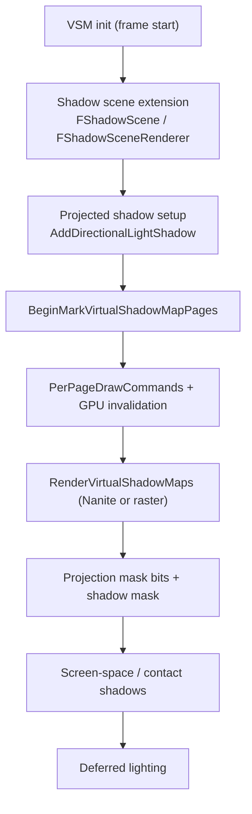

# 07 — Shadows

Six shadow systems coexist and are selected per light, per platform, per frame. They are not alternatives to each other in the usual sense — they cover different cost regimes, and a single frame can use three of them at once.

| System | Storage | Invalidated by | Gate |
|---|---|---|---|
| Cached shadow maps (CSM) | fixed resolution per cascade | light/primitive change, `FCachedShadowMapData` | `FCSMSceneExtension` (`Shadows/CSMSceneExtension.h:57`, `CSMSceneExtension.cpp:7`) |
| Virtual shadow maps (VSM) | paged, GPU-invalidated per instance | per-instance page invalidation | `FVirtualShadowMapArrayCacheManager` (`VirtualShadowMaps/VirtualShadowMapCacheManager.cpp:645`, `ShouldCreateExtension` `:647`) |
| Capsule shadows | tiled screen-space mask | per frame | `r.CapsuleShadows` (`CapsuleShadowRendering.cpp:37`), direct `:45`, indirect `:53` |
| Contact shadows | screen-space ray march | per frame | `r.ContactShadows` (`Shadows/ScreenSpaceShadows.cpp:469`), method `:27` |
| Ray-traced shadows | per-light batch | per frame | `r.RayTracing.Shadows.*` per light type (`LightRendering.cpp:121-139`), denoiser `:97` |
| Hair deep shadow | voxel page mask | per frame | `HairStrandsDeepShadow.cpp:226` |

## Virtual shadow maps

VSM is the only shadow system with a persistent cross-frame cache. `FVirtualShadowMapArray` (`VirtualShadowMaps/VirtualShadowMapArray.h:293`) owns a physical page pool; `FVirtualShadowMapArrayCacheManager` (`VirtualShadowMapCacheManager.cpp`, 87 graph edges) owns per-light cache entries and the GPU invalidation pipeline.

Hard limits enforced in code:

- `static_assert(VSM_MAX_SINGLE_PAGE_SHADOW_MAPS <= VSM_PAGE_SIZE * VSM_PAGE_SIZE, "All single-page SMs must fit in a single page.")` (`VirtualShadowMapArray.cpp:2647`) — the single-page shadow map budget is a compile-time function of page size.
- `ensure((NumSinglePageShadowMaps + Count) <= VSM_MAX_SINGLE_PAGE_SHADOW_MAPS)` (`:1092`) — exceeding it degrades to allocation failure, not an error.
- `check(PhysicalX <= GetMax2DTextureDimension())` and `check(PhysicalY <= GetMax2DTextureDimension())` (`:1037-1038`) — the physical pool is bounded by the RHI's maximum texture dimension.
- `check(FMath::IsPowerOfTwo(PhysicalPagesX))` (`:1012`) — page grid must be power-of-two.
- `check(PackedShadowMaskMaxLightCount <= 32)` (`:1150`) — the shadow mask is a 32-bit bitmask per pixel.
- `check((CacheEntry->GetVirtualShadowMapId() + CacheEntry->ShadowMapEntries.Num()) <= VirtualShadowMapArray.GetNumShadowMapSlots())` (`VirtualShadowMapCacheManager.cpp:1334`) — a cache entry cannot overrun the slot table.

Clipmaps get no mips (`BaseParams.TargetMipCount = 1; // No mips for clipmaps`, `:4963`), and clipmap passes are not batched (`:4673`), which is why a directional light with many clipmap levels shows many small draw passes in RenderGraphInsights.

GPU invalidation runs as compute: `FInvalidateInstancePagesLoadBalancerCS` (`VirtualShadowMapCacheManager.cpp:1694`), `FProcessInvalidationQueueGPUCS` (`:1730`), `FVSMResetInstanceStateCS` (`:2078`), `FVSMUpdateViewInstanceStateCS` (`:2196`), `FVirtualSmCopyStatsCS` (`:1383`). The load balancer is the same wrapped-group pattern described in [../RDG/08_Groups_Indirect_and_Dispatch_Ranges.md](../RDG/08_Groups_Indirect_and_Dispatch_Ranges.md).

## Frame integration

Registration sites: `DeferredShadingRenderer.cpp:1963` (VSM init), `:3274` (`BeginMarkVirtualShadowMapPages`), `:3354` (`CacheManager->ExtractFrameData`), `:2926`/`:2952`/`:3292` (`RenderShadowDepthMaps`). The shadow scene is a registered extension: `IMPLEMENT_SCENE_EXTENSION(FShadowScene)` (`Shadows/ShadowScene.cpp:44`), renderer `FShadowSceneRenderer` (`Shadows/ShadowSceneRenderer.h:46`, `DECLARE_SCENE_EXTENSION_RENDERER` `:49`), extension interface `FShadowScene` (`Shadows/ShadowScene.h:26`, `ShouldCreateExtension` `:53`).

## Design constraints

1. **VSM is unavailable in the forward path.** `ensureMsgf(!VirtualShadowMapArray.IsEnabled(), TEXT("Virtual shadow maps are not supported in the forward shading path"))` (`DeferredShadingRenderer.cpp:2925`).
2. **VSM is unavailable with early shadow rendering.** `ensureMsgf(!VirtualShadowMapArray.IsEnabled(), TEXT("Virtual shadow maps are not supported with r.shadow.ShadowMapsRenderEarly. Early shadow..."))` (`:2949`). The two flags are mutually exclusive, so a project that enables early shadows silently loses the VSM cache.
3. **VSM enablement is a platform decision, not a show flag alone.** `bEnableVirtualShadowMaps = UseVirtualShadowMaps(ShaderPlatform, FeatureLevel) && ViewFamily.EngineShowFlags.DynamicShadows && ...` (`:1962`).
4. **32-bit shadow mask** (`:1150`) caps how many lights can contribute to a pixel's shadow mask simultaneously.
5. **Extension lifetime matters**: `ShouldCreateExtension` is evaluated at scene creation (`VirtualShadowMapCacheManager.cpp:647`), and the comment at `:654` notes the shader platform can change during scene destruction, so the gate must be re-checked — a scene created on a non-VSM platform never gets the cache manager.

## Tech artist notes

- VSM cost is dominated by invalidation, not rendering: a scene with many moving primitives generates a large invalidation queue (`FProcessInvalidationQueueGPUCS`), which is a compute cost that appears before any shadow draw.
- Capsule shadows fade by angle (`CVarCapsuleShadowFadeAngleFromVertical` `:85`) and have separate direct/indirect distance limits (`:69`, `:77`); raising them increases tiled-culling cost, not shader cost.
- Contact shadows have their own intensity mode and fade window (`:54`, `:65`, `:74`) — a contact-shadow artifact is usually a fade-length mismatch, not a ray-march failure.
- `check(ScissorRect.Area() > 0)` (`ScreenSpaceShadows.cpp:295`, `:368`) fires when a view's scissor rect is empty, which happens with split-screen or partial-viewport views.

## Graph facts

- `VirtualShadowMaps/VirtualShadowMapCacheManager.cpp` 87 edges, `VirtualShadowMapArray.cpp` 84 edges; `FVirtualShadowMapArrayCacheManager` 81, `FVirtualShadowMapClipmap` 48.
- Renderer-module node counts: VirtualShadowMaps 436, Shadows 187, Froxel 15.
- `FVirtualShadowMapArrayCacheManager` is a registered scene extension, so it appears in the extension registry graph alongside `FShadowScene` and `FSceneCulling` (85 edges).
- Shader files are not graph nodes; the 37 VSM shader files (`Engine/Shaders/Private/VirtualShadowMaps/`) are invisible to graph queries.
