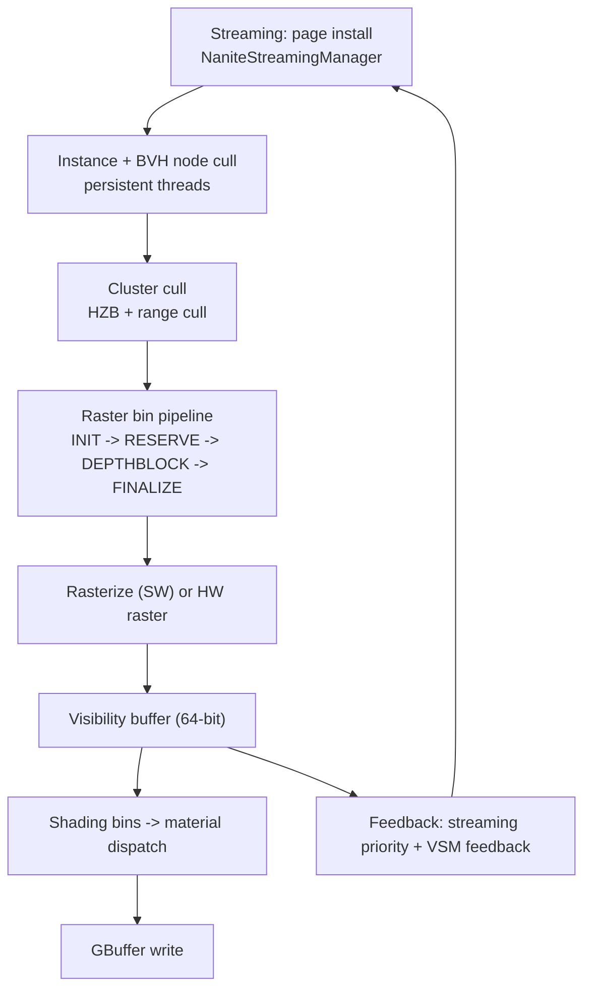

# 08 — Nanite

Nanite replaces the mesh-draw path with two GPU stages: **cluster culling** and **software rasterization**, followed by a shading stage that runs per material bin. There is no per-mesh draw call; work is generated by the GPU itself through indirect dispatch, so the pipeline's limits are encoded as bit-field widths, not as runtime checks.

## Pipeline stages



Stage registration: `NANITE_RASTER_BIN_INIT` (`NaniteCullRaster.cpp:1217`/`:1221`), `NANITE_RASTER_BIN_RESERVE` (`:1242`/`:1245`), `NANITE_RASTER_BIN_DEPTHBLOCK` (`:1268`), `NANITE_RASTER_BIN_FINALIZE` (`:1293`); the bin pass is a permutation dimension (`class FBuildPassDim : SHADER_PERMUTATION_SPARSE_INT("RASTER_BIN_PASS", NANITE_RASTER_BIN_COUNT, NANITE_RASTER_BIN_SCATTER)`, `:1136`). Tessellation is a separate permutation (`FTessellationDim` `:1527`, define set at `:1120`, `:1314`, `:1417`).

Dispatch is split by raster backend: `DispatchHW` (`:3434`) and `DispatchSW` (`:3676`). Curve geometry uses its own binning path (`:3358`).

## Bit-field limits

The candidate-node encoding is fixed-width, and the limits are compile-time:

```
static_assert(1 + NANITE_NUM_CULLING_FLAG_BITS + NANITE_MAX_INSTANCES_BITS <= 32, "FCandidateNode.x fields don't fit in 32bits");            // :46
static_assert(1 + NANITE_MAX_NODES_PER_PRIMITIVE_BITS + NANITE_MAX_VIEWS_PER_CULL_RASTERIZE_PASS_BITS <= 32, "FCandidateNode.y ...");        // :47
static_assert(1 + NANITE_MAX_BVH_NODES_PER_GROUP <= 32, "FCandidateNode.z ...");                                                             // :48
static_assert(NANITE_MAX_INSTANCES <= MAX_INSTANCE_ID, "Nanite must be able to represent the full scene instance ID range");                  // :49
```

These are not tunables at runtime: raising `NANITE_MAX_VIEWS_PER_CULL_RASTERIZE_PASS` or `NANITE_MAX_INSTANCES` requires re-encoding the candidate node, which changes the cull shader. Runtime checks at `:6918` and `:6925` re-verify the same packing for the pass-count path, and `checkf(false, TEXT("Unknown culling type: %d"), CullingType)` (`:4496`) is the fallthrough for the cull-type switch.

Persistent-thread culling is gated by `r.Nanite.PersistentThreadsCulling` (`:322-323`), and the pass asserts the RHI is configured for it: `checkf(GRHIPersistentThreadGroupCount > 0, TEXT("GRHIPersistentThreadGroupCount must be configured correctly in the RHI."))` (`:4630`, dispatch at `:4491`). A platform without persistent-thread support cannot run the instance-hierarchy-and-cluster-cull pass (`AddPass_InstanceHierarchyAndClusterCull` `:4626`).

Viewport offset is not supported: `checkf(TextureRect.Min.X == 0 && TextureRect.Min.Y == 0, TEXT("Viewport offset support is not implemented."))` (`:6509`).

## Packed views

Nanite does not consume `FViewInfo`; it consumes `FPackedView` (`NaniteShared.h:59`), built through `FPackedViewParams` (`:175`) into a `FPackedViewArray` (`:131`). Default flags are `NANITE_VIEW_FLAG_NEAR_CLIP` (`:185`); `RangeBasedCullingDistance` is only read when `NANITE_VIEW_FLAG_DISTANCE_CULL` is set (`:192`). The renderer packs views at `DeferredShadingRenderer.cpp:1565` (`CreateNaniteViews`) with `NANITE_VIEW_FLAG_HZBTEST | NANITE_VIEW_FLAG_NEAR_CLIP` (`:1578`).

Which HZB a view uses is decided per frame: Nanite HZB vs the standard HZB (`:1656`), with a prime-HZB gate (`:1662`, `:1667`) and `RenderSizeBias` (`:1672`). The HZB test rect is doubled (`HZBTestRect = HZBRenderViewRect * 2`, `:1693`) to cover the conservative raster footprint. Scene-culling instance culling runs before the Nanite pass (`:1711`), then `BuildHZBFurthest` (`:1733`) with depth-bias config (`:1747`).

## Shading stage

Shading is bin-based: material pipelines are collected per bin (`:2647`), and the shading mode is a CVar-selected strategy — `r.Nanite.ShadeBinningMode` (`NaniteShading.cpp:210`), `r.Nanite.BinningTechnique` (`:202`), `r.Nanite.BundleShading` (`:176`) with `r.Nanite.BundleEmulation` (`:163`), `r.Nanite.ComputeMaterialsSort` (`:189`). Fast tile clear variants (`:123`, `:131`, `:139`) and fast tile visibility (`:156`) are separate optimizations that can be validated (`r.Nanite.ValidateShadingBinUB` `:148`, `r.Nanite.ValidateShadeBinning` `:233`).

GBuffer precision is inherited from `r.GBufferFormat` (`NaniteShading.cpp:250-252`), so a Nanite frame's GBuffer layout follows the same rules as the raster path ([06_Base_Pass_GBuffer_and_Shading_Models.md](06_Base_Pass_GBuffer_and_Shading_Models.md)). Software VRS is applied here (`r.Nanite.SoftwareVRS` `:225`; see [17_Render_Scaling_VRS_and_Performance.md](17_Render_Scaling_VRS_and_Performance.md)).

## Feedback loops

Three feedback paths make Nanite self-adjusting:

1. **Streaming priority** — visibility results drive page install (`NaniteStreamingManager`, `Engine/Source/Runtime/Engine/Public/Rendering/NaniteStreamingManager.h`).
2. **VSM performance feedback** — `ExtractVSMPerformanceFeedback` (`NaniteCullRaster.cpp:7193`) feeds the virtual shadow map cache.
3. **Material performance warnings** — `r.Nanite.EmitMaterialPerformanceWarnings` (`NaniteFeedback.cpp:15`, evaluated `:100`, `:169`) reports materials whose complexity forces Nanite off the fast path.

Indirect args for the cull/raster dispatch are computed on the GPU (`CalculateClusterIndirectArgsBuffer` `:7264`), and `FeedbackStatus` (`:7508`) is the observable state of the feedback loop.

## Frame integration

Event scopes: `Nanite::VisBuffer` (`DeferredShadingRenderer.cpp:1533`, `:1762`), `Nanite::PrimeHZB` (`:1669`), `NaniteBasePass` (`:1789`). `RenderNanite` is defined at `:1449`; the renderer object is created per frame (`FRenderer`/`Nanite::IRenderer::Create` `:1764`), geometry is drawn (`:1777`) and results extracted (`:1784`). The renderer-module graph shows `FRenderer` at 89 edges and `Nanite::IRenderer` implementations in `NaniteCullRaster.cpp` (106 edges) and `NaniteShading.cpp` (102).

`check(Views.Num() == NaniteRasterResults.Num())` (`DeferredShadingRenderer.cpp:3211`) is the invariant tying views to raster results, and `check(!UseNanite(ShaderPlatform) || bNeedsPrePass)` (`DeferredShadingRenderer.cpp:2361`) is the ordering invariant between Nanite and the depth prepass.

## Design constraints

1. **Bit-field widths are the real capacity limits** (`:46-49`); they cannot be raised without changing the encoding.
2. **Persistent-thread support is required** for the cull pass (`:4630`).
3. **No viewport offset** (`:6509`) — split-screen and partial viewports need a full-viewport texture.
4. **Nanite requires a prepass when it is enabled** (`:2361`), so "skip the depth prepass" is not available on Nanite geometry.
5. **Nanite ray tracing is a separate LOD policy** — `r.Nanite.RayTracing.*` LOD bias and min cut error (`NaniteRayTracing.cpp:57`, `:63`, `:70`, `:76`), BLAS cache with relative error tolerance (`:92`, `:100`), size caps (`:109`, `:125`, `:133`), per-frame build budget (`:141`), CLAS buffer (`:176`, `:184`). `FRayTracingManager` is the highest-degree Nanite symbol (125 edges, `NaniteRayTracing.h`).

## Tech artist notes

- `r.Nanite.MaxPixelsPerEdge` (`NaniteCullRaster.cpp:133`) is the quality knob; `r.Nanite.PrimaryRaster.PixelsPerEdgeScaling` (`:332`) is the dynamic-resolution multiplier on top of it. They interact: the second scales the first, so a low `MaxPixelsPerEdge` with high scaling can still produce a large cluster count.
- A material that forces per-pixel shading complexity disables bundle shading: `UseShadingShaderBundle(EShaderPlatform)` is defined at `NaniteShading.cpp:262` and consulted at `:272`, `:718`, `:1834` — the single biggest Nanite performance cliff.
- Streaming stalls show as `FeedbackStatus` (`:7508`) not reaching steady state; the symptom is pop-in, not a shader error.

## Graph facts

- Nanite subsystem: 1,343 nodes in the Renderer module. Top symbols: `FRayTracingManager` 125 (`NaniteRayTracing.h`), `NaniteCullRaster.cpp` 106, `NaniteShading.cpp` 102, `FRenderer` 89, `NaniteShared.h` 87, `FPackedView` 61, `FNaniteRasterPipeline` 49.
- 58 Nanite shader files exist (`Engine/Shaders/Private/Nanite/`) but shader files are not graph nodes, so the raster bin permutation logic is invisible to graph queries.
- `NaniteResources.h` and `NaniteStreamingManager.h` live in `Engine/Source/Runtime/Engine/Public/Rendering/`, which is why Nanite spans the Engine and Renderer modules (Engine → Renderer 1,076 edges, Renderer → Engine 1,441).
