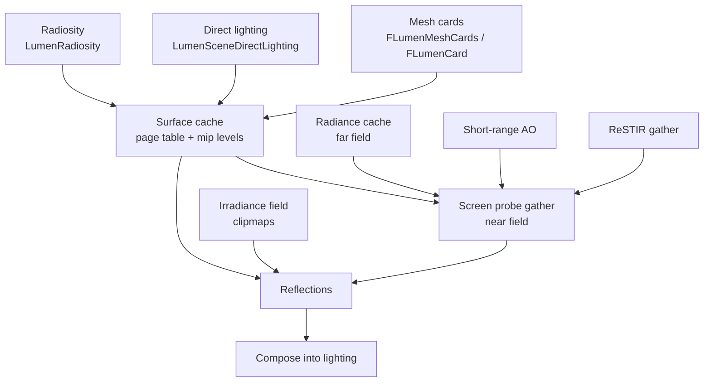

# 09 — Lumen

Lumen is a set of cooperating lighting estimators over one shared surface cache. The cache is the reason the rest can be cheap: every estimator samples cards rather than re-tracing the scene, so cache quality and update policy determine final image quality more than ray counts.

## Surface cache

`FLumenSceneData` (`Lumen/LumenSceneData.h`, 161 graph edges) owns cards, the page table (`FLumenPageTableEntry` `:43`), mip maps (`FLumenSurfaceMipMap` `:236`, `FLumenMipMapDesc` `:271`), card sharing (`FLumenCardSharingInfo` `:169`, pending add/remove `:184`, `:206`) and culling info (`FLumenCardCullingInfo` `:281`). `FLumenCardId` is fixed at 64 bits: `static_assert(sizeof(FLumenCardId) == sizeof(uint64), "Unexpected size of FLumenCardId")` (`:162`).

Lumen is **not** a scene extension — there is no `IMPLEMENT_SCENE_EXTENSION` in `LumenScene.cpp`, so its state lives directly on `FScene` and its frame state in `FLumenSceneFrameTemporaries` (73 graph edges). This is why Lumen cannot be disabled per scene the way VSM or Substrate can.

Allocation invariants enforced at runtime:

- `check(PageTableEntry.IsMapped())` (`LumenSceneRendering.cpp:1015`, `:1116`, `:1209`)
- `check(CardCaptureAllocation.PhysicalPageCoord.X >= 0)` (`:886`, `:1020`, `:1121`)
- `check(CardCullingInfo.DesiredLockedResLevelOnLastAlloc != Request.ResLevel)` (`:941`)
- `check(Card.MinAllocatedResLevel <= CardSharingInfo->MinAllocatedResLevel)` (`:1000`)
- `ensure(Request.IsLockedMip())` (`:814`)
- `check(LumenSceneData.NumMeshCardsToAdd == 0)` (`:1384`) — the card set must be settled before frame rendering
- `check(InstanceCullingInfos.IsAllocated(CullingInfoIndex) && CullingInfo.NumInstances == 0)` (`:606`)

Card capture asserts the shader contract: `check(RenderTargetsInfo.RenderTargetsEnabled == 3)` (`LumenSceneCardCapture.cpp:547`) — the capture pass writes exactly three render targets; `check(!ShadingCommand.IsBindless())` (`:259`); `check(ShadingPipeline.ComputeShader)` (`:366`); `check(CompletionEvent.IsValid())` (`:345`, PSO compilation check). Card orientation is asserted geometrically: `ensureMsgf(DotProduct(CardWorldOBB.AxisX, CrossProduct(CardWorldOBB.AxisY, CardWorldOBB.AxisZ)) < 0.0f, TEXT("Card has..."))` (`:722`) — cards must be left-handed OBBs.

## Estimators

| Estimator | Scope | Key control |
|---|---|---|
| Screen probe gather | per pixel, near field | `Lumen/LumenScreenProbeGather.cpp`; adaptive probes `:47`; integration tile classification `:103`; backface diffuse `:111`; diffuse integral method `:119`; material AO `:127`; interpolation depth weight `:134` (foliage `:142`, fallback `:151`) |
| ReSTIR gather | per pixel, reservoir resampling | `LumenReSTIRGather.cpp`; downsample `:31`; temporal resampling `:47` with validation `:55` and history threshold `:63`; spatial resampling `:79`, passes `:87`, samples `:95`, kernel radius `:103`, angle threshold `:111`, depth error threshold `:119`, occlusion screen-trace distance `:127`; max ray intensity `:135` |
| Radiance cache | world-space probes, far field | `LumenRadianceCache.cpp`; update `:16`, force full update `:31`, temporary atlas downsample `:23`, probe filtering `:46`, trace-tile sort `:54`, irradiance probe offset mode `:62`, supersample BRDF threshold `:94`, supersample/downsample distance `:101`, `:109` |
| Radiosity | card-to-card indirect | `LumenRadiosity.cpp`; enable `:21`, probe spacing `:29`, hemisphere resolution `:37`, spatial filter `:45`, kernel size `:53`, plane weighting `:61`, occlusion `:69`, strength `:77`, depth scale `:85`, HW bias `:116`, `:123` |
| Reflections | per pixel | `LumenReflections.cpp`; enable `:22`, checkerboard downsample `:36`, radiance-cache path `:51`, min/max roughness `:65`/`:72`, trace distance `:79`/`:86`, roughness fade `:93`, max roughness to trace `:108`, clamp `:115`, foliage `:122` |
| Irradiance field | clipmap probes | `LumenIrradianceFieldGather.cpp`; clipmaps `:19`, world extent `:27`, distribution base `:35`, probe budget `:42`, resolution `:50`, probe resolution `:58`, irradiance resolution `:66`, occlusion resolution `:74`, mips `:81`, atlas `:89`, bias `:97`, short-range AO radius `:105`, downsample `:121` |
| Short-range AO | per pixel | `LumenShortRangeAOHardwareRayTracing.cpp:24`, normal bias `:32` |

## Near field vs far field

`Lumen::UseFarField(ViewFamily)` (`Lumen/Lumen.h:142`) is the switch that changes which estimator answers a query; `UseFarFieldOcclusionOnly()` (`:143`) splits occlusion from lighting, and `GetNearFieldMaxTraceDistanceDitherScale()` (`:145`) / `GetNearFieldSceneRadius()` (`:146`) bound the near-field domain. A far-field hit is an approximation from the radiance cache; a near-field hit is a real trace. The visible consequence is the well-known "reflections pop when the camera moves" artifact: the boundary between the two domains is a distance, not a quality setting.

## Hardware vs software ray tracing

Each estimator has an independent HWRT gate, and all of them require `IsRayTracingEnabled()` plus a CVar:

- Screen probe: `CVarLumenScreenProbeGatherHardwareRayTracing` (`LumenScreenProbeHardwareRayTracing.cpp:23`), far field `:52`, gate `:64-66`; biases `:31`, `:38`, `:45` (hair).
- Radiance cache: `CVarLumenRadianceCacheHardwareRayTracing` (`LumenRadianceCacheHardwareRayTracing.cpp:21`), far field `:28`, gate `:42` (also enabled by the translucency radiance-cache reflection path).
- Short-range AO: `CVarLumenShortRangeAOHardwareRayTracing` (`LumenShortRangeAOHardwareRayTracing.cpp:24`), gate `:47-48` — additionally requires `!Lumen::SupportsMultipleClosureEvaluation(platform) || GRHISupportsRayTracingDispatchIndirect`, i.e. on Substrate platforms it needs indirect dispatch support.

Shader-execution-reordering is a permutation that must be validated against the platform: `if (PermutationVector.Get<FUseShaderExecutionReordering>() && !FDataDrivenShaderPlatformInfo::GetSupportsShaderExecutionReordering(Platform))` (`LumenScreenProbeHardwareRayTracing.cpp:187`, `LumenRadianceCacheHardwareRayTracing.cpp:157`). A platform that reports no SER support cannot use the SER permutation even if the CVar enables it.

Group-size permutations are asserted, not defaulted: `check(ComputeLightingPDFGroupSize != MAX_uint32)` (`LumenScreenProbeImportanceSampling.cpp:409`), `check(GenerateRaysGroupSize != MAX_uint32)` (`:444`), `ensureMsgf(CompositeScatterThreadGroupSize != MAX_uint32, TEXT("Missing permutation for FScreenProbeCompositeTracesWithScatterCS"))` (`LumenScreenProbeFiltering.cpp:465`), `ensureMsgf(CalculateMovingThreadGroupSize != MAX_uint32, TEXT("Unsupported gather resolution"))` (`:497`). A gather resolution without a permutation is a hard failure, which is why non-standard screen percentages can break Lumen.

## Update policy and async

Lumen scene lighting is incremental: force-full-update `:106`, feedback `:25`, frustum prioritization `:32`, direct update factor `:41`, radiosity update factor `:49`, stats `:57`, async compute `:64` gated by `Lumen::UseAsyncCompute(ViewFamily)` (`:211`). Frame hooks: `BeginUpdateLumenSceneTasks` (`DeferredShadingRenderer.cpp:1967`), `BeginGatherLumenLights` (`:1970`), `UpdateLumenScene` (`:2895`), `FinishGatheringLumenSurfaceCacheFeedback` (`:4337-4338`).

## Design constraints

1. **Lumen cannot be a scene extension**, so its memory is per-scene and unconditional once enabled.
2. **Card capture writes exactly 3 render targets** (`LumenSceneCardCapture.cpp:547`); a material that cannot produce those three outputs is skipped, not partially captured.
3. **Bindless is not supported in card capture** (`:259`).
4. **PSO completion is required before capture** (`:345`), so first-frame capture stalls are expected.
5. **Substrate interaction**: `SupportsMultipleClosureEvaluation` (`Lumen.h:155-156`) changes the AO dispatch shape and therefore the HWRT gate (`LumenShortRangeAOHardwareRayTracing.cpp:48`).
6. **History is stateful**: disocclusion handling has its own frame budget (`LumenScreenProbeFiltering.cpp:21`, `:29`) and history distance thresholds (`:77`, `LumenScreenProbeGather.cpp:174`, `:181`, ReSTIR `:63`); clearing history every frame (`:167`) removes the temporal filter's benefit entirely.

## Tech artist notes

- Roughness thresholds decide which pixels get real traces (`LumenReflections.cpp:108`, `:115`, `:122`); a smooth surface beyond the threshold falls back to the radiance cache, which is the source of most "blurry reflection" complaints.
- Foliage has separate thresholds throughout (`:142`, `:181`, `:122`) because planar surfaces break plane-weighted filtering.
- `r.Lumen.ScreenProbeGather.NumAdaptiveProbes` (`:47`) and integration tile classification (`:103`) are the cost knobs; the visual result changes before the ray count does.

## Graph facts

- Lumen subsystem: 2,220 nodes in the Renderer module. Top symbols: `FLumenSceneData` 161 (`LumenSceneData.h`), `LumenScene.cpp` 82, `FLumenSceneFrameTemporaries` 73, `LumenSceneDirectLighting.cpp` 61, `FLumenCard` 53.
- 95 Lumen shader files exist (`Engine/Shaders/Private/Lumen/`); shader files are not graph nodes, so permutation logic is invisible to graph queries.
- Lumen reaches RDG in 5 hops (`FLumenSceneData` → `Lumen.h` → `RHIShaderPlatform.h` → `RHIDefinitions.h` → `RenderGraphBuilder.h`), i.e. through the platform gate rather than through a direct call — consistent with the fact that Lumen's behaviour is platform-conditional.
