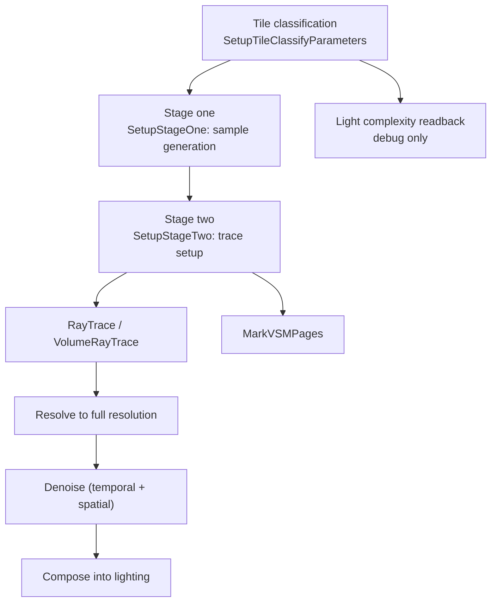

# 10 — MegaLights

MegaLights is a tile-based light-sampling pipeline: classify tiles by light complexity, generate a small number of samples per tile, trace them, then resolve back to full resolution. It is designed for scenes with many lights, where per-pixel-per-light evaluation is the bottleneck — the cost model is per-tile, not per-pixel, so light count matters more than pixel count.

## Gates

Three independent gates must all pass, and they fail for different reasons:

| Gate | Line | Meaning |
|---|---|---|
| `CVarMegaLightsSupported` | `MegaLights/MegaLights.cpp:19` | project-level; the comment at `:22` states it exists so MegaLights shaders can be skipped entirely at compile time |
| `CVarMegaLightsProjectSetting` | `:26` | project setting |
| `CVarMegaLightsAllowed` | `:33` | runtime allow, platform-dependent |

Because the first gate affects shader compilation, a project that disables MegaLights does not have the shaders available at all — enabling it later requires a shader recompile, not a CVar change.

## Stage structure

`FMegaLightsViewContext` (`MegaLights/MegaLightsInternal.h:375`, 180 graph edges) is the per-view state; `FMegaLightsFrameTemporaries` (`:653`) is the per-frame state; `FGPUBufferReadbackCollection` (`:631`) is the CPU-visible readback used by the debug views.

Definitions: `SetupTileClassifyParameters` (`MegaLights.cpp:1041`), `SetupStageOne` (`:1369`), `SetupStageTwo` (`:1841`), `MarkVSMPages` (`:2020`), `RayTrace` (`:2053`), `VolumeRayTrace` (`:2096`), `TileClassificationMark` (`:1301`).

Stage one generates samples: `ClearLightSamples` (`MegaLightsSampling.cpp:371`), `GenerateSamples DownsampleFactor:%dx%d SamplesPerPixel:%dx%d TileType:%s` (`:434`). Directional lights get a separate sample fraction (`CVarMegaLightsDirectionalLightSampleFraction` `:7`) with its own clamping weight (`:14`), and rays can be merged (`CVarMegaLightsMergeRays` `:35`, applied `:410`).

Stage two chooses the trace backend per tile: screen traces (`CVarMegaLightsScreenTraces` `MegaLightsRayTracing.cpp:58`, quality `:65`, max iterations `:74`, max distance `:81`, minimum occupancy `:88`, relative depth threshold `:95`, thickness when no fallback `:102`, normal bias `:110`, distant screen traces `:117`) or world-space traces (`:141`), with software ray tracing allowed separately (`:148`) and hardware ray tracing with inline mode (`:155`, `:162`) and a material-evaluation mode (`:169`). Compaction group sizes are explicit (`:44`, `:51`).

Resolve (`MegaLightsResolve.cpp`): shading confidence `:9`, max shading weight `:16`, a different weight when the light is hidden and history is used (`:23`, `:83`), guide-by-history filters for the main, volume and translucency-volume paths (`:31`, `:38`, `:45`), screen trace for transmission (`:52`, `:59`), and a light-index scalarization threshold (`:66`). Volume visible-light hash passes are separate: `VolumeVisibleLightHash` (`:730`), `TranslucencyVolumeVisibleLightHash` (`:761`), `VolumeFilterVisibleLightHash` (`:793`).

Denoising (`MegaLightsDenoising.cpp`): temporal (`:17`) with history distance `:24`, min frames accumulated for a history miss `:31`, max frames `:38`, neighborhood clamp `:45`; spatial (`:52`) with depth weight `:59`, kernel radius `:66`, samples `:73`, max disocclusion frames `:80`, separate diffuse and specular variance scales (`:87`, `:94`), history spatial variance (`:101`, `:108`); front-layer translucency has its own temporal path (`:115`).

## Async compute

MegaLights decides async per stage, not globally: `IsAsyncComputeAllowed()` (`MegaLights.cpp:2122`), `VolumeUseAsyncCompute()` (`:2127`), `GenerateSamplesUseAsyncCompute()` (`:2133`). The light-power-delta pass has its own async CVar (`MegaLightsLightPowerDelta.cpp:14`) and sets `ERDGPassFlags::AsyncCompute` accordingly (`:90`). See [05_Pass_Catalog_and_Frame_Order.md](05_Pass_Catalog_and_Frame_Order.md) for the global async rules.

## Light complexity feedback

MegaLights measures per-tile light complexity and reads it back to the CPU (`FGPUBufferReadbackCollection` `:631`), which is what makes the debug views possible. Frozen-data integrity is asserted on the readback path: `check(GlobalFrozenDataBytes + NumLights * LightFrozenDataBytes <= (uint32)FrozenLightData.Num())` (`MegaLightsVisualizeLightComplexity.cpp:491`), `check(ReadPtr - FrozenLightData.GetData() == GlobalFrozenDataBytes)` (`:506`), `check(ReadPtr - LightDataStart == LightFrozenDataBytes)` (`:543`), `check(MegaLightsViewState && !MegaLightsViewState->DumpLightDataReadback)` (`:860`), `checkNoEntry()` (`:140`).

VSM interaction: `MarkVSMPages` (`MegaLights.cpp:2020`) — MegaLights tells the virtual shadow map which pages to render, so disabling MegaLights on a many-light scene changes VSM page allocation, not just lighting.

## Design constraints

1. **Project-level gate affects compilation** (`:22`); a disabled project setting means no shaders, not a runtime fallback.
2. **Screen traces need occupancy** (`:88`): a tile below the minimum occupancy falls back to world-space tracing, which is a different cost model.
3. **No-fallback thickness** (`:102`) exists because screen traces cannot resolve when the fallback is disabled — a screen-trace miss is not a black pixel, it is a re-trace.
4. **Readback is a frame boundary**: the debug views read GPU data on the CPU, so `checkNoEntry()` (`:140`) guards the frozen-data state machine; visualizing light complexity adds a stall.
5. **Simple lights are excluded by ID convention**: `Defaults to -2 to avoid selecting simple lights whose LightIds are -1` (`:1632`) — simple lights are outside the MegaLights sampling model.

## Tech artist notes

- `r.MegaLights.Visualize` (`MegaLightsVisualize.cpp:13`, `check(VisualizeMode > 0)` `:471`) and `r.MegaLights.VisualizeLightComplexity` (`MegaLightsVisualizeLightComplexity.cpp:24`, clamped 0–5 `:105`) are the diagnostic surfaces; the shadow-caster quality thresholds (`MegaLightsVisualize.cpp:37`, `:42`) classify proxies as missing or poor, which is how you find a light that is not casting shadows from a distant proxy.
- `r.MegaLights.VisualizeLightComplexityFreeze` (`:50`, `:119`) freezes the readback so a frame can be inspected without the value changing — the only way to compare two frames.
- Samples per pixel (`MegaLights.cpp:60`) and min sample weight (`:69`) trade noise against resolve cost; the denoiser's max accumulated frames (`MegaLightsDenoising.cpp:38`) is what limits how much noise can be cleaned over time.

## Graph facts

- MegaLights subsystem: 541 nodes in the Renderer module. Top symbols: `FMegaLightsViewContext` 180 (`MegaLightsInternal.h`), `MegaLights.cpp` 85, `MegaLightsRayTracing.cpp` 59, `RayTraceLightSamples()` 28, `SetupStageOne()` 24.
- `FMegaLightsViewContext` reaches `FRDGBuilder` in 4 hops through `GenerateMegaLightsSamples()` (`MegaLights.cpp:1282` → `:2321`) → `ERDGPassFlags` (`RenderGraphBuilder.h:477`) — the pass-flag type is the join point, which reflects that MegaLights' RDG relationship is entirely through pass registration.
- 32 MegaLights shader files exist (`Engine/Shaders/Private/MegaLights/`); shader files are not graph nodes.
