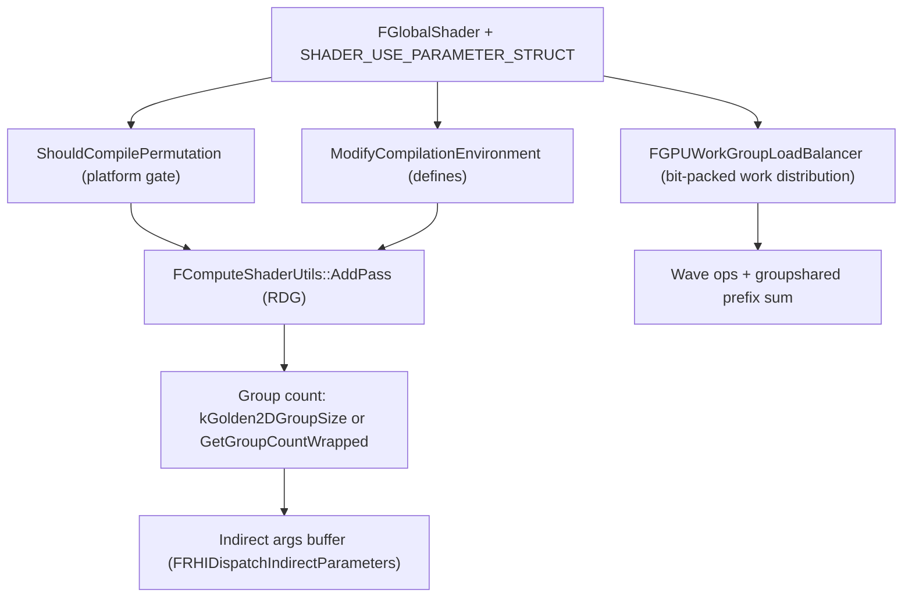

# 12 — Compute Shader Infrastructure

Compute is the substrate almost every other subsystem is built on: instance culling, Nanite culling and rasterization, Lumen tracing, MegaLights sampling, VSM invalidation, hair visibility, virtual texture allocation, HZB, sorting. The infrastructure that makes them shareable is small — permutation gates, group-size policy, wave ops, prefix sums, and a bit-packed work-group load balancer.

## Shader declaration and permutation gates

`SHADER_USE_PARAMETER_STRUCT` binds a C++ struct to the HLSL parameter block; `SHADER_PARAMETER_RDG_TEXTURE` (`RenderCore/Public/ShaderParameterMacros.h:1697`) is the RDG-aware variant, distinct from `SHADER_PARAMETER_SRV` (`:1649`) and `SHADER_PARAMETER_UAV` (`:1668`) — RDG variants take `FRDGTextureRef`, which is what lets RDG track access and insert transitions (see [../RDG/03_Declared_Access_and_Transitions.md](../RDG/03_Declared_Access_and_Transitions.md)).

Two hooks decide whether a permutation exists at all:

- `ShouldCompilePermutation` — default `return true` (`RenderCore/Public/Shader.h:848`); the function-pointer type is `ShouldCompilePermutationType` (`:1256`), stored per shader type (`:1299`, `:1551`).
- `ModifyCompilationEnvironment` — default no-op (`:842`), type `ModifyCompilationEnvironmentType` (`:1263`), stored at `:1306`, `:1558`.

A subsystem that gates on a platform capability must do it in `ShouldCompilePermutation`, not at dispatch time; a dispatch that selects a permutation which was not compiled is a runtime failure. Lumen's SER check (`LumenScreenProbeHardwareRayTracing.cpp:187`) is the canonical example.

## Group size policy

`RenderCore/Public/RenderGraphUtils.h`:

- `kGolden2DGroupSize = 8` (`:336`) — the default 2D compute tile.
- `WrappedGroupStride = 128` (`:380`), chosen because "128 appears to be the lowest common denominator" across platforms (`:376`).
- `GetGroupCountWrapped` (`:388`) asserts `GRHIMaxDispatchThreadGroupsPerDimension.X >= WrappedGroupStride && ...Y >= WrappedGroupStride` (`:390`), then converts a linear count into a wrapped 2D grid (`:396-397`).
- The shader must recover the linear group id: `LinearGroupId = GroupId.X + (GroupId.Z * WrappedGroupStride + GroupId.Y) * WrappedGroupStride` (`:385`), which is why `GetUnWrappedDispatchGroupId` exists in the load-balancer shaders (`InstanceCulling/InstanceCullingLoadBalancer.ush:168`).

A subsystem that hard-codes its own group size cannot use the wrapped path; that is why several subsystems assert their permutation instead of falling back — `check(ComputeLightingPDFGroupSize != MAX_uint32)` (`LumenScreenProbeImportanceSampling.cpp:409`), `ensureMsgf(CompositeScatterThreadGroupSize != MAX_uint32, TEXT("Missing permutation for FScreenProbeCompositeTracesWithScatterCS"))` (`LumenScreenProbeFiltering.cpp:465`), `ensureMsgf(NumThreadGroups.X * NumThreadsPerGroup <= MaxSupportedInstances)` (`InstanceCullingOcclusionQuery.cpp:388`).

## Work-group load balancer

`FGPUWorkGroupLoadBalancer` (`Renderer/Private/GPUWorkGroupLoadBalancer.h:15`) packs each work item into 32 bits:

| Field | Bits | Line |
|---|---|---|
| `ThreadGroupSizeLog2` | 6 → `ThreadGroupSize` 64 | `:18-19` |
| `PrefixBits` | 6 | `:20` |
| `PrefixBitMask` | `(1<<6)-1` | `:21` |
| `NumItemBits` | 6 | `:22` |
| `PayLoadBits` | `32 - (1 + 6 + 6)` = 19 | `:24` |

The packing is only valid inside those ranges, enforced by `checkSlow`: `NumItems - 1 < (1U << NumItemBits)` (`:41`), `FirstItem < (1U << (32U - NumItemBits))` (`:42`), `BatchPrefixSum < (1U << PrefixBits)` (`:61`). A workload larger than 64 items per batch or a payload needing more than 19 bits cannot use this balancer — that is the hard constraint behind per-subsystem item limits.

The shader side unpacks the same layout (`Engine/Shaders/Private/WorkGroupLoadBalancer.ush`): `FWorkGroupInfo` with `WorkGroupWorkBoundary` (`:12-14`), `FWorkGroupItem` with `BatchPrefixSum` (`:36`), `UnpackItem` extracting `BatchPrefixSum` from `(PackedItem.Packed >> (1u + WGLB_NUM_ITEM_BITS)) & WGLB_PREFIX_BIT_MASK` (`:45`). The defines come from `FGPUWorkGroupLoadBalancer::SetShaderDefines` (`GPUWorkGroupLoadBalancer.h:152`), and the comment at `WorkGroupLoadBalancer.ush:5` states that any CS using the file must use that function — a shader that hard-codes its own defines will disagree with the C++ packing.

`GetWrappedCsGroupCount()` is the dispatch-count entry point (`GPUWorkGroupLoadBalancer.h:146`); `TGPUWorkGroupLoadBalancer` (`:172`) is the typed wrapper that includes `FGPUWorkGroupLoadBalancer::FShaderParameters` into the permutation struct (`:196`) and calls `GetParametersAsync` (`:203`), `FinalizeParametersAsync` (`:212`), `FinalizeBatches` (`:221`). The instance-culling variant implements it directly (`InstanceCulling/InstanceCullingLoadBalancer.h:107`, `:216`) and documents the extra bit needed for the case where one item has a full thread group of work (`InstanceCulling/InstanceCullingLoadBalancer.ush:26`).

## Wave ops and prefix sums

`Engine/Shaders/Private/WaveOpUtil.ush`: `WaveActiveSum` (`:64`), `WavePrefixSum` (`:71`, `:93`). `Engine/Shaders/Private/ThreadGroupPrefixSum.ush` builds a group-wide prefix sum from wave results using a double-buffered `groupshared` workspace (`:28`) with `GroupMemoryBarrierWithGroupSync()` (`:35`), and it fails at compile time if the group size is not declared: `#error NUM_THREADS_PER_GROUP must be defined, and must be equal to the thread group size of the caller of ThreadGroupPrefixSum` (`:24`) — a mismatch between the C++ dispatch size and the HLSL define is a compile error, not a runtime bug.

`Engine/Shaders/Private/WorkDistribution.ush` distributes work within a wave only: "Work won't be distributed wider than the same wave" (`:10`), with `groupshared` queues sized `THREADGROUP_SIZE * 2` (`:33-34`) and `WorkBoundary[THREADGROUP_SIZE]` (`:35`), using `WaveGetLaneCount()` (`:39`). This is why wave-ops permutations exist per subsystem (`CVarLumenScreenProbeGatherWaveOps` `LumenScreenProbeGather.cpp:33`, `CVarMegaLightsWaveOps` `MegaLights.cpp:93`, `CVarLumenScreenProbeFilteringWaveOps` `LumenScreenProbeFiltering.cpp:101`) — a platform without wave intrinsics cannot use these paths.

## Indirect dispatch

Indirect args are allocated as an RDG indirect buffer: `FRDGBufferDesc::CreateIndirectDesc<FRHIDispatchIndirectParameters>()` (`RenderGraphUtils.cpp:883`), written by `FInitIndirectArgs1DCS` (`:863`, `IMPLEMENT_GLOBAL_SHADER` `:878`, `Engine/Shaders/Private/Tools/SetupIndirectArgs.usf` `InitIndirectArgs1DCS` `:12`, `WriteDispatchIndirectArgs(IndirectDispatchArgsOut, 0, GroupCount, 1, 1)` `:16`), exposed as `PF_R32_UINT` UAV (`:890`) under event name `InitIndirectArgs1D` (`:895`). Subsystems that compute their own dispatch counts do the same thing with their own buffers — `Nanite::CalculateClusterIndirectArgsBuffer` (`NaniteCullRaster.cpp:7264`), Substrate's three indirect buffers (`Substrate.cpp:356-358`).

## Root constants and bindless

`Engine/Shaders/Public/RootConstants.ush` exposes the pass data as four root constants (`GetAllRootConstants()` `:14`, `GetRootConstant0..3` `:16-19`), with the platform include selected at `:7` and `:9`. `Engine/Shaders/Public/BindlessResources.ush` defaults `SUPPORTS_BINDLESS_UNIFORM_BUFFER` to 0 (`:7-8`) and undefines it when `ConstantBuffer<>` support is absent (`:11`, `:14-15`); heap declarations are only emitted under `UE_BINDLESS_ENABLED` (`:18`) for SRV (`:19-20`), UAV (`:23-24`), CBV (`:27-28`), sampler (`:31-32`). Lumen card capture asserts the non-bindless path: `check(!ShadingCommand.IsBindless())` (`LumenSceneCardCapture.cpp:259`).

## Design constraints

1. **Group size is a permutation, not a runtime value.** A missing permutation is a hard failure (`LumenScreenProbeFiltering.cpp:465`, `:497`).
2. **Wrapped dispatch requires a platform that allows 128 groups per dimension** (`RenderGraphUtils.h:390`); the shader must unwrap the group id (`:385`).
3. **Load-balancer packing is 32 bits total** (`GPUWorkGroupLoadBalancer.h:24`); 64 items per batch and 19 payload bits are hard limits.
4. **HLSL defines must match C++ constants** (`WorkGroupLoadBalancer.ush:5`, `ThreadGroupPrefixSum.ush:24`).
5. **Wave ops are a platform capability**, gated per subsystem.
6. **`Engine/Shaders/Compute` does not exist** — compute shaders live inside subsystem directories under `Engine/Shaders/Private`, so there is no single place to audit them.

## Tech artist notes

- Persistent-thread dispatch is a separate mechanism from indirect dispatch: `r.Nanite.PersistentThreadsCulling` (`NaniteCullRaster.cpp:322-323`) uses `FIntVector(GHIPersistentThreadGroupCount, 1, 1)` (`:4491`) with `checkf(GHIPersistentThreadGroupCount > 0, ...)` (`:4630`).
- `r.Nanite.ValidateShadingBinUB` (`NaniteShading.cpp:148`) and `r.Nanite.ValidateShadeBinning` (`:233`) validate the group-size permutation tables at dispatch time — the cheapest way to confirm a binning configuration is actually valid.
- `r.RHICmdMinDrawsPerParallelCmdList` (`NaniteShading.cpp:97`) is the threshold below which parallel command-list splitting stops paying off.

## Graph facts

- RenderCore module: 7,571 nodes; RHI: 5,286; Renderer: 22,449. Shader files (`.usf`/`.ush`) are not graph nodes — 0 shader nodes in the graph — so permutation logic and HLSL helper usage are invisible to graph queries.
- `RenderCore/Public/RenderGraphUtils.h` is the join point between subsystems and RDG: `AddPostProcessingPasses()` reaches `FRDGBuilder` in 4 hops through `TryRegisterExternalTexture()` (`RenderGraphUtils.h:254`).
- Highest-degree render-scope files: `Core/Public/IO/IoDispatcherPriority.h` 65,654, `Math/UnrealMathUtility.h` 26,349, `CoreMinimal.h` 15,081, `RenderCore/Public/Shader.h` 379 nodes, `ShaderCompiler.h` 376 nodes.
