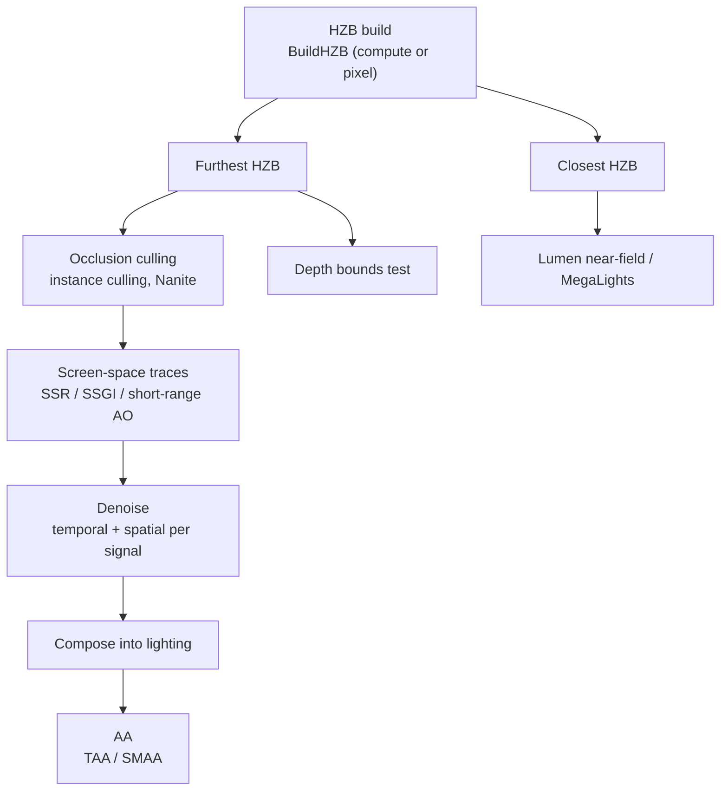

# 13 — Screen-Space Techniques

Screen-space techniques share one constraint: they only know what is already on the screen. Every one of them is a guess about occlusion, and the frame's HZB is the arbiter of that guess. The pipeline therefore has a strict order — HZB first, then screen-space traces, then denoising, then composition — and each stage's quality is bounded by the stage before it.

## HZB

`BuildHZB` (`Renderer/Private/SceneTextureReductions.cpp:111`) has two shader forms — `FHZBBuildPS` (`:38`) and `FHZBBuildCS` (`:63`) — selected by `r.HZB.BuildUseCompute` (default 1, `:16-18`). The compute form batches mips: `kMaxMipBatchSize = 4` (`:68`), exposed as a permutation range `SHADER_PERMUTATION_RANGE_INT("DIM_MIP_LEVEL_COUNT", 1, kMaxMipBatchSize)` (`:74`) and as UAV arrays of size 4 (`:80-81`); the pixel form is limited to 1 (`:164`).

The two HZB types are not interchangeable, and the code asserts which one a caller expects: `check(!bProduceFroxelData)` (`:277`), `check(bOutputFurthest)` (`:278`), `check(!bOutputClosest)` (`:279`), `check(ClosestHZBTexture)` (`:354`), `check(OutFurthestHZBTexture)` (`:363`). `BuildHZBFurthest` (`:372`) is the convenience wrapper.

Consumers and their requirements:

| Consumer | Requirement | Line |
|---|---|---|
| Instance culling occlusion query | furthest HZB valid | `InstanceCullingOcclusionQuery.cpp:587`, `:930` (`checkf ... IsHZBValid(View, EHZBType::FurthestHZB)`) |
| Nanite culling | `NANITE_VIEW_FLAG_HZBTEST \| NANITE_VIEW_FLAG_NEAR_CLIP` | `DeferredShadingRenderer.cpp:1578` |
| Lumen | `bLumenNeedsClosestHZB` | `:1419` |
| MegaLights | `MegaLights::IsUsingClosestHZB` | `:1433` |
| Froxel | `check(!bProduceFroxelData)` for the furthest path | `SceneTextureReductions.cpp:277` |
| Async HZB | `r.SceneDepthHZBAsyncCompute` (default 0), mode 2 requires `ComputeLightGridOutput.CompactLinksPass` | `DeferredShadingRenderer.cpp:2714-2728`, `:2720` |

The HZB render rect is doubled (`HZBTestRect = HZBRenderViewRect * 2`, `:1693`) so that a screen-space trace can read texels outside the current view rect — this is why screen-space techniques work better when the camera is not moving than the CVar settings suggest.

## Screen-space reflections

`ScreenSpaceRayTracing.cpp`: quality `:44`, half-res input `:58`, temporal `:65`, stencil `:72`, compute `:79`. Several SSGI CVars are deprecated in 5.8 (`FCVarDeprecationArgs{ TEXT("5.8") }` at `:86`, `:97`, `:103`, `:109`) — leak-free reprojection `:85`, minimum luminance `:96`, reject uncertain rays `:102`, terminate certain ray `:108` — which means the SSGI path is now driven by Lumen, not by these CVars.

Tiled composition (`ScreenSpaceReflectionTiles.cpp`) is gated by indirect-draw support: `UseSSRIndirectDraw(View.GetShaderPlatform()) && CVarSSRTiledComposite.GetValueOnRenderThread()` (`:135`, `:144`), with tile categorization passes `SSR::TileCategorisationMarkTiles` (`:188`) and `SSR::TileCategorisationBuildList` (`:212`). Min specular is clamped to `[-0.001, 1.001]` (`:183`), two-sided foliage is optional (`:184`), and the comment at `:48` records a real platform problem: Vulkan errors on the atomic usage in the tile categorization mark CS and Metal differs.

## Denoising

`ScreenSpaceDenoise.cpp` is signal-based: shadow (`:26`-`:46`), reflection (`:53`-`:72`), AO (`:77`-`:97`), each with reconstruction sample count, pre-convolution count, temporal accumulation, and history convolution sample count.

Structural limits: `kMaxMipLevel = 2` (`:134`), `kStackowiakMaxSampleCountPerSet = 56` (`:137`), `kMaxBufferProcessingCount = kMaxDenoiserBufferProcessingCount` (`:140`), and `static_assert(IScreenSpaceDenoiser::kMaxBatchSize <= kMaxBufferProcessingCount, "Can't batch more signal than there is internal buffer in the denoiser")` (`:145`). The resource-name tables are asserted against the signal enum: `static_assert(UE_ARRAY_COUNT(kReconstructionResourceNames) == int32(ESignalProcessing::MAX) * kMaxBufferProcessingCount, ...)` (`:762`), repeated for rejection pre-convolution (`:763`), temporal accumulation (`:764`), history convolution (`:765`), and output (`:766`) — adding a signal type without updating every table is a compile error. Batch size is a permutation range (`:356`), and an unknown signal falls through to `check(0)` (`:324`).

## Temporal AA

`PostProcess/TemporalAA.cpp`: filter size `:22`, Catmull-Rom `:28`, pause correction `:34`, current frame weight `:40`, quality `:46`, history screen percentage `:55` clamped to `[1.0, 2.0]` (`:525`), upscaler `:61`, R11G11B10 history `:69`, mobile config `:74`, mobile compute `:82`. `check(Validate())` (`:539`) is the pass-level contract check.

TAA and TSR share history structures: `FTemporalAAHistory` (`PostProcess/TemporalAA.h:13`), `FTSRHistory` (`:15`), `FTAAOutputs` (`:74`), `FTAAPassParameters` (`:98`), `FDefaultTemporalUpscaler` (`:211`), `FTSRPassConfig` (`:255`), `FVisualizeTemporalUpscalerInputs` (`:311`).

## SMAA

`PostProcess/SubpixelMorphologicalAA.cpp`: quality clamped 0–3 (`:185`), edge detection mode clamped to the enum (`:206`), three passes — `SMAAedgeDetection` (`:224`), `SMAABlendingWeightCalculation` (`:281`), `SMAANeighborhoodBlending` (`:317`). The lookup textures are engine-global and required: `check(GEngine->SMAAAreaTexture && GEngine->SMAASearchTexture)` (`:258`) — SMAA cannot run before those textures are created, which is why it fails in some headless or early-frame paths.

## Motion blur

`PostProcess/PostProcessMotionBlur.cpp`: filtering `:18`, second scale `:27`, scatter `:33`, separable `:39`, directions `:45`, half-res input `:51`, half-res gather `:56`, external velocity flatten `:61`, VR allow `:66`, visualize `:78`. Motion blur reads the velocity buffer, so it depends on `bShouldRenderVelocities` (`DeferredShadingRenderer.cpp:2444`) — a view that skips velocity (e.g. `SKIP_VELOCITY_MASK`, `ShadingCommon.ush:43`) produces no motion blur.

## Design constraints

1. **HZB type is a contract**, asserted per call site (`SceneTextureReductions.cpp:277-279`, `:354`, `:363`); a consumer cannot request the other type.
2. **Compute HZB batches 4 mips** (`:68`); a resolution with more mips needs multiple dispatches.
3. **Denoiser batch size cannot exceed internal buffer count** (`:145`), and the resource-name tables must match the signal enum (`:762-766`).
4. **Tiled SSR requires indirect-draw support** (`ScreenSpaceReflectionTiles.cpp:135`), so it is off on platforms without it regardless of the CVar.
5. **SMAA requires engine-global lookup textures** (`:258`).
6. **Screen-space techniques need the previous frame's data** — history textures (`TemporalAA.h:13`, `:15`) are per-view-state, so a new view or a view-fork loses them.

## Tech artist notes

- Screen-space quality is bounded by the HZB rect being 2× the view rect (`DeferredShadingRenderer.cpp:1693`); content near the screen edge is the first thing to break.
- Denoiser CVars are per signal (`ScreenSpaceDenoise.cpp:26-97`); changing reflection samples does not affect AO.
- `r.SMAA.Quality` (`:13`) and `r.SMAA.EdgeDetectionMode` (`:31`) are clamped, so out-of-range values silently fall back.
- Deprecated SSGI CVars (`:86`, `:97`, `:103`, `:109`) still exist but no longer drive the Lumen path — a project that relies on them is measuring the wrong thing.

## Graph facts

- PostProcess subsystem: 1,519 nodes in the Renderer module; `PostProcessGBufferHints.cpp` is the highest-degree render-scope file at 14,890 edges, and `AddPostProcessingPasses()` (103 edges) reaches `FRDGBuilder` in 4 hops through `TryRegisterExternalTexture()` (`RenderGraphUtils.h:254`).
- Shader file counts: `Engine/Shaders/Private/ScreenSpaceDenoise/` 20, `Engine/Shaders/Private/SSRT/` 6, `Engine/Shaders/Private/SMAA/` 7, `Engine/Shaders/Private/Bloom/` 11, `Engine/Shaders/Private/TemporalSuperResolution/` 23. Shader files are not graph nodes, so the denoiser's resource-name tables (`ScreenSpaceDenoise.cpp:762-766`) are the only graph-visible link between the C++ batch model and the HLSL implementation.
- `Renderer/Internal/PostProcess/SubpixelMorphologicalAA.h` shows the module's internal-header split: `Internal/` headers are not in `Public/`, so SMAA is not callable from outside the Renderer module.
