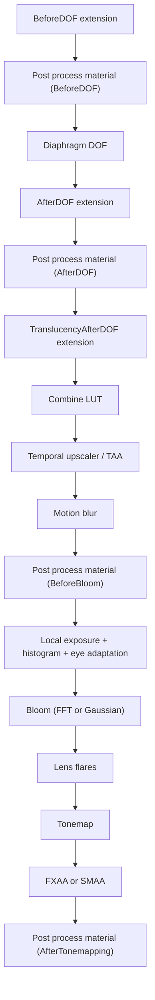

# 14 — Post Process Chain

The post process chain is a fixed sequence with named slots. Extensions and post process materials can only attach at those slots, and the pass sequence decides whether a slot runs. The order is not configurable — what is configurable is whether each named pass is enabled, and which material or delegate overrides it.

## Pass sequence

`TOverridePassSequence<EPass> PassSequence` (`PostProcess/PostProcessing.cpp:622`) is the mechanism: names are registered (`:623`), each pass is enabled or disabled (`:624`-`:685`), after-pass callbacks are collected (`:726`, `:748`), and `PassSequence.Finalize()` (`:853`) locks it. Two asserts pin the enum: `static_assert(static_cast<uint32>(EPass::MAX) == UE_ARRAY_COUNT(PassNames), "EPass does not match PassNames.")` (`:620`) and `static_assert(static_cast<int32>(EPass::MotionBlur) == 0)` (`:824`) — MotionBlur is the first pass in the sequence.

`PassSequence.AcceptOverrideIfLastPass(...)` (`:738`) is how a post process material or extension delegate claims the output of a pass; only the last claim wins, which is why two materials at the same blend point behave differently from one.

## Execution order (verified)

| Stage | Line | Note |
|---|---|---|
| Eye adaptation buffer initialised to last frame's | `:472`-`:474` | comment `:471` "Default the new eye adaptation to the last one in case it's not generated this frame" — `EyeAdaptationBuffer = LastEyeAdaptationBuffer` is a fallback, not the value used downstream; the eye adaptation pass (`:1440` or `:1451`) reassigns it to this frame's result, and `:1624` passes that to tonemap |
| Pass enable decisions | `:624`-`:685`, `:815`-`:822` | visualize passes gated on show flags and `GIsEditor` (`:638`-`:654`) |
| BeforeDOF extension | `:894`-`:898` | `AddSceneViewExtensionPassChain` (defined `:383`) |
| Post process material BeforeDOF | `:962` | `BL_SceneColorBeforeDOF` (`:889`) |
| Diaphragm DOF | `:976` | `DiaphragmDOF::AddPasses` |
| AfterDOF extension | `:1009`-`:1012` | `BL_SceneColorAfterDOF` (`:890`) |
| Post process material AfterDOF | `:1018` | |
| TranslucencyAfterDOF extension | `:1029`-`:1034` | `BL_TranslucencyAfterDOF` (`:891`) |
| Combine LUT | `:1089` | async-compute comment `:1081`; external LUT fallback `:1094`, `:1099` |
| Temporal upscaler / TAA | `:1156`, `:1163`, `:1170` | inputs built `:1110`-`:1149`; `check(UpscalerPassInputs.SceneColor.ViewRect == View.ViewRect)` `:1151` |
| SSR input material | `:1231` | `BL_SSRInput` |
| Motion blur | `:1269` | visualize variant `:1265` |
| Post process material BeforeBloom | `:1315` | `BL_SceneColorBeforeBloom` (`:812`) |
| Local exposure (bilateral) | `:1369` | method must be `Bilateral` (`:1367`) |
| Histogram | `:1406` | atomic variant `:454`, `Histogram Atomic %dx%d (CS)` `:404` |
| Local exposure blurred log luminance | `:1432` | |
| Eye adaptation | `:1440` (basic), `:1451` (histogram), `:1461` (fusion) | `bBasicEyeAdaptationEnabled` `:869` |
| Bloom | `:1506` (FFT), `:1555` (setup), `:1564` (Gaussian) | FFT and Gaussian are mutually exclusive: `check(!IsFFTBloomEnabled(View))` `:200` |
| Lens flares | `:1571` | downsample stage index derived from quality `:1570` |
| Tonemap | `:1629` | replaceable by delegate `:1604` or material `:1610` |
| FXAA / SMAA | `:1648` / `:1661` | `AAM_FXAA` / `AAM_SMAA` `:818`, `:819` |
| Post process material AfterTonemapping | `:1676` | `BL_SceneColorAfterTonemapping` (`:813`) |

Mobile chain: `AddMobilePostProcessingPasses` — BeforeDOF `:3054`, LocalExposure `:3104`, LensFlares `:3354`, AfterDOF `:3439`, TAA `:3466`, CombineLUT `:3554`, FXAA `:3621`, SMAA `:3636`. It is a separate implementation, not a subset, so a project that relies on a desktop-only stage (e.g. local exposure bilateral) gets different behaviour on mobile.

## Blend points and inputs

`EPostProcessMaterialInput` (`Renderer/Public/PostProcess/PostProcessMaterialInputs.h:21-38`): `SceneColor` 0 (always active), `SeparateTranslucency` 1, `CombinedBloom` 2, `PreTonemapHDRColor` 2 — aliased with `CombinedBloom` — `PostTonemapHDRColor` 3, `Velocity` 4. The aliasing is intentional: the same slot means different things depending on the blend point, documented at `:18-20` ("Inputs are aliased and have different semantics based on the post process material blend point"). `BL_TranslucencyAfterDOF` selects `SeparateTranslucency` instead of the aliased input (`:83`).

`EPathTracingPostProcessMaterialInput` (`:40-47`) is a separate enum: `Radiance`, `DenoisedRadiance`, `Albedo`, `Normal`, `Variance`.

## Eye adaptation and exposure

`PostProcessEyeAdaptation.cpp`: pre-exposure override `:69`, method override `:77`, exponential transition distance `:88`, lens attenuation `:104`, black histogram bucket influence `:110`, exposure compensation curve LUT `:118` with sample count `:125` and range `:131`/`:137`, ignore materials `:143`, luminance method `:150`, reconstruct from scene color `:158`, evaluation position bias `:164`.

The comment at `PostProcessing.cpp:785` is the important behavioural note: "We don't test for the EyeAdaptation engine show flag here. If disabled, the auto exposure pass is still executes but performs a..." — disabling auto exposure in the show flags does not remove the pass; it changes what the pass does. Eye adaptation is stateful (`View.HasEyeAdaptationViewState()` `:789`), so a new view inherits nothing.

## Tonemap and LUT

`PostProcessCombineLUTs.cpp`: color min/mid/max clamped to `[-10, 10]` (`:116`-`:118`), LUT size `:39`, inner size `:45`, async compute `:51`, color grading `:57`, update every frame `:62`, inner update every frame `:67`, tonemapping method `:72`, SDR inverse EOTF `:80`.

`PostProcessTonemap.cpp`: sharpen `:34` (CVar overrides settings only when ≥ 0, `:132-133`), gamma `:44`, `r.Gamma` `:51`, film grain sequence length `:57` and cached constants `:62`, backbuffer quantization dithering override `:67`, LUT shaper `:73`, HDR display max luminance override `:288`-`:289`. Film grain builds a texture under its own event scope (`:521`).

## Bloom

`PostProcessBloomSetup.cpp`: cross `:18`, `check(Inputs.SceneColor.IsValid())` `:122`, `check(Inputs.EyeAdaptationBuffer)` `:123`, `check(bLocalExposureEnabled || bThresholdEnabled)` `:129`, `checkf(SceneDownsampleChain && SceneDownsampleChain->GetStageCount() == static_cast<uint32>(EBloomQuality::MAX), ...)` `:199` — the downsample chain must have exactly as many stages as the quality enum, `check(!IsFFTBloomEnabled(View))` `:200`, `check(BloomQuality != EBloomQuality::Disabled)` `:215`, `check(BloomQualityIndex < BloomQualityCountMax)` `:248`.

`PostProcessFFTBloom.cpp`: screen percentage clamped to `[0.1, MaxResolutionFraction]` (`:231`), kernel cache `:22` used only with view state (`:338`), async compute `:27`, resolution warning `:32`, `check(View.FFTBloomKernelTexture && View.FFTBloomKernelTexture->TextureRHI)` `:318`, kernel center `:386`, survey `:422`, reduce `:435`, max scatter dispersion `:460`, center energy `:488`.

## Design constraints

1. **The chain order is fixed**; only enable/disable and override are configurable (`:622`-`:853`).
2. **`EPass` must match `PassNames`** (`:620`), and MotionBlur is index 0 (`:824`).
3. **Bloom quality determines the downsample chain length** (`:199`); a quality change reallocates the chain.
4. **FFT and Gaussian bloom are exclusive** (`:200`).
5. **Bloom requires an eye-adaptation buffer** (`:123`), so disabling auto exposure changes bloom, not just exposure.
6. **Upscaler output must match the view rect exactly** (`:1151`).
7. **SMAA requires engine-global lookup textures** (`SubpixelMorphologicalAA.cpp:258`).

## Tech artist notes

- `VisualizePostProcessStack` (`:627`, disabled at `:629` in some paths) is the only way to see which pass produced a given output; the after-pass callbacks (`:726`, `:748`) are what the visualizer hooks.
- Post process materials at `BL_ReplacingTonemapper` replace the tonemapper entirely (`:1604`, `:1610`) — the highest-priority delegate wins, so two materials at that blend point are not additive.
- `r.PostProcess.AllowStencilTest` (`PostProcessMaterial.cpp:41`) and `r.PostProcess.AllowBlendModes` (`:49`) are required for a material to use those features; `check(Material)` (`:81`, `:122`, `:129`, `:149`, `:428`) and `check(false)` (`:169`) mark the unsupported blend points.

## Graph facts

- PostProcess subsystem: 1,519 nodes in the Renderer module; `AddPostProcessingPasses()` 103 edges, `PostProcessEyeAdaptation.cpp` 54, `SceneRenderTargets.h` 51.
- `PostProcessing.cpp` joins RDG through `TryRegisterExternalTexture()` (`RenderGraphUtils.h:254`) — 4 hops from `AddPostProcessingPasses()` to `FRDGBuilder`, the shortest path in the render scope.
- Shader file counts: `Engine/Shaders/Private/Bloom/` 11, `Engine/Shaders/Private/ACES/` 8, `Engine/Shaders/Private/SMAA/` 7, `Engine/Shaders/Private/TemporalSuperResolution/` 23. Shader files are not graph nodes.
