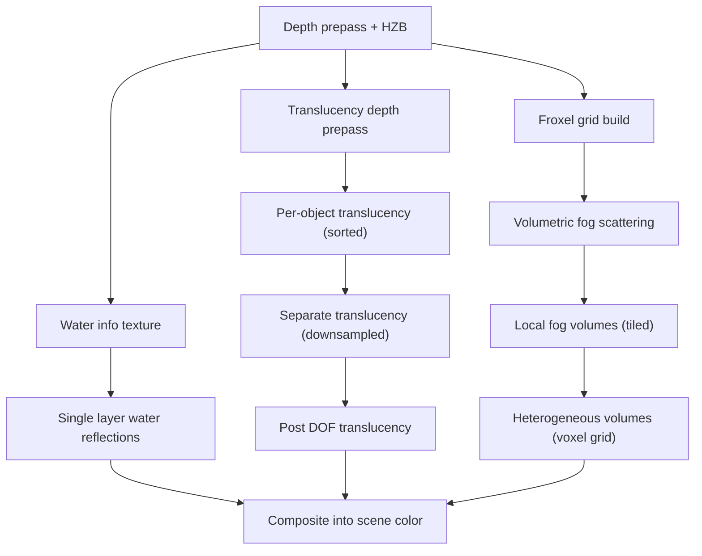

# 15 — Translucency, Volumetrics and Water

Four systems that all resolve order-dependent coverage: per-object translucency, volumetric fog, water, and the tile-based fog volumes. Each has its own sorting or accumulation model, and each is gated separately.

## Translucency

Pass types are `ETranslucencyPass` (`TranslucentRendering.h:26`), mapped to mesh passes by `TranslucencyPassToMeshPass()` (`:77`) and named by `TranslucencyPassToString()` (`:80`). `ShouldDrawInTranslucentBasePass()` (`:105`) decides whether a material draws in the base pass or in a later pass; `IsSeparateTranslucencyEnabled()` (`:92`) takes the downsample scale as an argument, so a material can be separate-translucent at full resolution and not at reduced resolution.

`GetTranslucentBlendState()` (`:168`) is per-material and per-pass; `TranslucentRenderStateNeedsStencilMask()` (`:103`) is why OIT and stencil interact.

Dynamic resolution is a per-bucket heuristic (`TranslucentRendering.cpp:172`-`:181`): model `Quadratic` (`:173`), `bModelScalesWithPrimaryScreenPercentage` depends on `CVarTranslucencyScreenPercentageBasis` (`:174`), min/max fraction from CVars (`:175`, `:176`), `BudgetMs` (`:177`), `ChangeThreshold` (`:178`), `TargetedHeadRoom` (`:179`), `UpperBoundQuantization` (`:180`). Screen-percentage CVars: `:89`, `:97`, `:104`, `:110`, `:116`, `:122`, `:128`, `:134`.

Holdout is a distinct pass: `check(PassType == ETranslucencyPass::TPT_TranslucencyHoldout)` (`:468`, `:666`), `check(TranslucencyPassResources.ColorTexture.IsValid())` (`:667`), `ensure(SceneColorTexture->Desc.Flags & TexCreate_RenderTargetable)` (`:669`), scope `ComposeHoldoutWithCoverage` (`:690`). Two `ensure`s guard the copy-back path: `ensure(View.ViewRect == UpscaledTranslucency.ViewRect)` (`:479`) and `ensure(UpscaledTranslucency.Texture == SceneColorTexture)` (`:480`) — the upscaler must have written into the exact texture the translucency pass expects.

## Order-independent translucency

`OIT.h`: `EOITPassType` (`:16-21`) — `OITPass_None` 0, `OITPass_RegularTranslucency` 1, `OITPass_SeparateTranslucency` 2. `FTriangleSortingOrder` (`:23`), `FSortedTriangleData` (`:30`) holds `SourceIndexBuffer` (`:32`), `SortedIndexBuffer` (`:33`), `SortedFirstIndex` (`:35`), `SortedPrimitiveType` (`:44`), `IsValid()` (`:46`). `FOITSceneData` (`:64`) owns `Allocations` (`:72`), `FreeBuffers` (`:73`), `PendingDeletes` (`:74`) — a buffer pool with a deferred-delete queue, sized by `CVarOIT_SortedTriangles_Pool` (`OIT/OIT.cpp:35`) and released at `PoolReleaseThreshold` (`:41`).

Sorted pixels are a separate mechanism with its own pass type (`:63`), sample count (`:69`), method (`:81`), and transmittance threshold (`:87`). `check(0)` at `TranslucentRendering.cpp`-adjacent `ScreenSpaceDenoise.cpp:324` and `OIT` debug scopes (`OIT.cpp:161`, `:252`) show the two paths are not interchangeable.

`check(TranslucencyMeshPass != EMeshPass::Num)` (`TranslucentRendering.cpp:240`) is the guard that a translucency pass has a registered mesh pass processor.

## Volumetric fog

Froxel geometry (`Froxel/Froxel.h:12-15`): froxels are "as deep as they are wide (at the near plane of the froxel slice)", which is the basis for the conservative depth test. Grid pixel size default 16 (`VolumetricFog.cpp:118`), clamped to ≥ 1 by `GetVolumetricFogGridPixelSize()` (`:239`); grid depth `:127`. Temporal reprojection `:135`, jitter `:143`, history weight `:151`, history-miss supersample count `:159`.

Light injection: shadowed lights injected separately (`:103`), emissive `:176`, rect light texture `:184`, conservative depth `:192`, ray-traced lights `:200`. Scopes: `VolumetricFog::RaytraceDirLightShadow` (`:647`), `VolumetricFog::LocalLights` (`:911`), `ShadowedLights` (`:989`), `RayTracedShadowedLights` (`:1094`).

## Local fog volumes

Tiled, not per-pixel: tile pixel size clamped to `[8, 512]` (`LocalFogVolumeRendering.cpp:86`), max instance count per tile `:50`, culling on async compute `:55`, HZB usage `:70`, half resolution `:75`, global start distance `:65`. Rendering can be folded into the height-fog pass (`:25`) or into volumetric fog (`:30`) with a density cap (`:35`) — the two paths are mutually exclusive per volume.

## Heterogeneous volumes

Voxel-grid pipeline (`HeterogeneousVolumes/HeterogeneousVolumesVoxelGridPipeline.cpp`): top-level transmittance `:1190`, majorant grid build `:1360`, downsample `:1399`, copy-max `:1422`, top-level voxel size `:1870`, bottom-level allocation `:1933`, raster tile generation `:1990`. `check(VisibleLightInfo != nullptr)` (`:604`, `:615`). Gates: enable `:18`, allowed `:25`, shadows `:32`, translucency `:39`, type `:46`, downsample `:55`, composition `:62`, upsample `:72`, filter `:82`, filter width `:93`, shadow type `:100`, shadow pipeline `:108`, hardware ray tracing `:123`.

## Sparse volume texture

The data model lives in `Runtime/Engine`, not Renderer: `FTextureData` (`Engine/Public/SparseVolumeTexture/SparseVolumeTextureData.h:40`), `FTextureDataCreateInfo` (`:13`), `FTextureDataAddressingInfo` (`:29`), `FDerivedTextureData` (`:74`). Bounds asserts in `Engine/Private/SparseVolumeTexture/SparseVolumeTextureData.cpp`: grid/page bounds `:73`, `:87`, `:97`, `:140`, `:142`, `:206`, `:208`, allocation invariant `check((NumAllocatedPages + 1) == NextPageTableEntry)` (`:280`), mip consistency `check(PageTableResolution == ShiftRightAndMax(Header.PageTableVolumeResolution, MipLevel, 1))` (`:343`). Two design notes at `:11` and `:14`: neighbour tagging for bilinear filtering across empty pages, and deterministic physical tile order.

Streaming manager (`Engine/Private/SparseVolumeTexture/SparseVolumeTextureStreamingManager.h:95`) implements `IStreamingManager`; `FTileAllocator` (`:49`), `FTileUploader` (`:43`), `FPageTableUpdater` (`:44`). The Renderer side is only the viewer (`Renderer/Private/SparseVolumeTexture/`, 8 files), scope `SparseVolumeTextureViewer` (`SparseVolumeTextureViewerRendering.cpp:113`).

## Single layer water and water info

Water: enable `:41`, wave ops `:46`, reflections `:68`, downsample `:73`, checkerboard downsample `:79` ("when DownsampleFactor is greater than one", `:82`), screen-space reconstruction `:85`, denoising `:91`, tiled composite `:97`, SSR TAA `:102`, distance-field shadow support `:110` and enable `:115`, cloud shadow `:120`, VSM filtering `:125`. `check(Views.Num() > 0)` (`:319`), `check(bCopyDepth || bCopyColor)` (`:1017`), `ensure(InstancedViewIndex != INDEX_NONE)` (`:1051`), `ensureMsgf(LegacyValue == -1, ...)` (`:1113`). Tiled scopes `SLW::TileCategorisationMarkTiles` (`:923`) and `SLW::TileCategorisationBuildList` (`:954`, `:986`).

Water info texture (`WaterInfoTextureRendering.cpp`): underground dilation offset `:18`, minimum overwrite distance `:24`, capture-next-draws `:30`. `check(EffectiveMaterial)` (`:489`, `:587`), `check(DefaultMaterial)` (`:573`), quality level from `GetCachedScalabilityCVars().MaterialQualityLevel` (`:571`, `:585`) — the water info material is quality-selected, so a lower quality level can resolve to a different material. `ensure(Draws.InstanceRuns.Num() + 2 <= Draws.InstanceRuns.Max())` (`:751`) is the same instance-run packing limit as Lumen card capture (`LumenSceneCardCapture.cpp:910`). Scope `WaterInfoTexture` (`:802`), sub-scopes `WaterInfoTexture(Terrain)` and `WaterInfoTexture(DilatedWaterBodies)` (`:921`), `ensure(VisibleMeshDrawCommandsNum == PassDraws[PassIdx].VisibleMeshCommands.Num())` (`:898`).

## Design constraints

1. Translucency resolution is a heuristic bucket, not a fixed percentage (`:172`-`:181`); it can change frame to frame, which is why the copy-back asserts (`:479`, `:480`) exist.
2. OIT sorted-index buffers are pooled with a deferred-delete queue (`OIT.h:72-74`); a frame that allocates more than the pool holds will reallocate.
3. Sorted pixels require a UAV only when sample count is 1 (`TranslucentRendering.cpp:1082`).
4. Froxel depth equals width at the slice near plane (`Froxel.h:14`), so grid pixel size controls both screen and depth resolution.
5. SVT physical tile order is deterministic only when the corresponding flag is on (`SparseVolumeTextureData.cpp:14`).
6. Water info materials are quality-dependent (`:571`, `:585`).

## Tech artist notes

- `r.Translucency.DynamicRes.*` (`:116`-`:134`) is the whole translucency resolution control surface; `ChangeThreshold` (`:128`) prevents oscillation.
- `r.OIT.SortedPixels.Debug` (`OIT/OIT.cpp:75`) and `r.OIT.SortedTriangles.Debug` (`:29`) are separate visualizers for the two OIT paths.
- `r.HeterogeneousVolumes.Debug` (`:116`) and `r.LocalFogVolumes.Tile.Debug` (`:60`) visualize tile allocation, not shading.
- `r.Water.SingleLayer.ShadersSupportDistanceFieldShadow` (`:110`) and `r.Water.SingleLayer.DistanceFieldShadow` (`:115`) are different: the first enables the shader permutation, the second enables the feature.

## Graph facts

- Renderer-module nodes per subsystem: HeterogeneousVolumes 618, SparseVolumeTexture 77, OIT 102, Froxel 15.
- `HeterogeneousVolumesVoxelGridPipeline.cpp` 1,275 edges and `HairStrandsVisibility.cpp` 1,282 are the highest-degree volumetric/hair files; both reach RDG through `GpuProfilerTrace.h:170` (3 hops from `HairStrandsVisibility.cpp`).
- Shader file counts: `Engine/Shaders/Private/HairStrands/` 79, `Engine/Shaders/Private/LocalFogVolumes/` 3, `Engine/Shaders/Private/OIT/` 1, `Engine/Shaders/Private/SparseVolumeTexture/` (viewer only). Shader files are not graph nodes.
