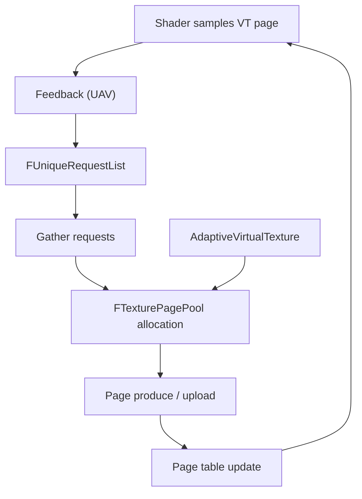

# 16 — Hair Strands, Decals and Virtual Texturing

Three subsystems that share one trait: they resolve coverage through a per-tile or per-page indirection rather than per-pixel shading. Hair uses tiles plus a voxel hierarchy, decals use a stage-and-target-mode table, virtual texturing uses a page table.

## Hair strands

Support gate: `IsHairStrandsSupported(EHairStrandsShaderType Type, EShaderPlatform Platform)` (`HairStrands/HairStrandsInterface.cpp:175`) — 118 edges, the highest-degree hair symbol. `check(MeshBatch.PrimitiveSceneProxy && MeshBatch.PrimitiveSceneProxy->ShouldRenderInMainPass())` (`:461`, `:480`) and `check(VFTypeA != nullptr)` / `check(VFTypeB != nullptr)` (`:629`, `:630`). Comment at `:316`: "This ensures that the groom is correctly updated if visible in shadows" — hair visibility is not view-only; shadow passes drive it.

Three visibility models, each with its own sample budget:

| Model | CVar | Lines |
|---|---|---|
| MSAA | `r.HairStrands.Visibility.MSAA.SamplePerPixel` / `.MeanSamplePerPixel` | `:88`, `:89` |
| Compute | `r.HairStrands.Visibility.Compute.SamplePerPixel` / `.MeanSamplePerPixel` | `:93`, `:94` |
| PPLL | `r.HairStrands.Visibility.PPLL`, `.SamplePerPixel`, `.MeanSamplePerPixel` | `:113`, `:114`, `:115` |

Material compaction thresholds (`:83`, `:84`) control how strands merge into material groups; `r.HairStrands.Visibility.ResolutionScaleAware` (`:100`) makes the sample budget scale with screen percentage; `r.HairStrands.VelocityType` (`:108`) and `r.HairStrands.VelocityMagnitudeScale` (`:102`) select the velocity filtering model; `r.HairStrands.Visibility.Clear` (`:97`) forces a buffer clear; `r.HairStrands.Visibility.HairCount.DistanceThreshold` (`:118`) gates the per-tile hair count.

Data structures (`HairStrands/HairStrandsData.h`): `FHairStrandsTiles` (`:60`), `FHairStrandsVisibilityData` (`:100`), `FPackedVirtualVoxelNodeDesc` (`:146`), `FHairStrandsVoxelResources` (`:214`), `FMinHairRadiusAtDepth1` (`:232`), `FHairStrandsDeepShadowData` (`:240`). Frame asserts: `check(In->TileData.IsValid())` (`HairStrandsRendering.cpp:48`), `check(View.HairStrandsViewData.bIsValid && View.HairStrandsViewData.VirtualVoxelResources.IsValid())` (`:376`).

Frame integration: `HairRendering` is called at `DeferredShadingRenderer.cpp:3934`, `:4019`, `:4053`; `HairStrands::PostRender` at `:4378`; the render-curve path is a scene extension (`HairStrands/RenderCurveSceneExtension.cpp:15`). Shader dir: `Engine/Shaders/Private/HairStrands/` 79 files.

## Decals

Decal rendering is a table of (stage, target mode). `EDecalRenderStage` (`DecalRenderingCommon.h:35-57`): `None` 0, `BeforeBasePass` 1 (DBuffer), `BeforeLighting` 2 (GBuffer), `Mobile` 3, `MobileBeforeLighting` 4, `Emissive` 5, `AmbientOcclusion` 6, `Num`. `EDecalRenderTargetMode` (`:60-72`): `None` 0, `DBuffer` 1, `SceneColorAndGBuffer` 2, `SceneColorAndGBufferNoNormal` 3, `SceneColor` 4, `AmbientOcclusion` 5, `Num`. `EDecalRasterizerState` (`:75-80`): `Undefined`, `CCW`, `CW` — decal rasterization winding is resolved per view (`:127`, `:130`).

The decal write mask is a bitfield (`:24-30`): `RenderStageMask : 8`, `bWriteBaseColor : 1`, `bWriteNormal : 1`, `bWriteRoughnessSpecularMetallic : 1`, `bWriteEmissive : 1`, `bWriteAmbientOcclusion : 1`, `bWriteDBufferMask : 1`. A decal can write attributes in one pass and AO in another (`:53`), which is why `AmbientOcclusion` is a separate stage.

Visibility: `FVisibleDecal` (`DecalRenderingShared.h:24`), `FDecalVisibilityViewPacket` (`:46`), `FDecalVisibilityTaskData` (`:96`), `FDecalViewInfo` (`:145`). `check(IsInRenderingThread())` (`DecalRenderingShared.cpp:155`, `:166`), `check(View.IsPerspectiveProjection())` (`:440`) — the fade-by-screen-size calculation (`CVarDecalFadeScreenSizeMultiplier` `:55`, used `:435`) assumes perspective projection.

## Virtual texturing

`FVirtualTextureSystem` (`VT/VirtualTextureSystem.h:27`, 110 edges) coordinates `FVirtualTextureSpace` (`:26`), `FVirtualTexturePhysicalSpace` (`:24`), `FVirtualTextureProducer` (`:25`), `FUniqueRequestList` (`:23`), `FUniquePageList` (`:22`), `FAdaptiveVirtualTexture` (`:19`); `FTexturePagePool` is only a friend declaration there (`:207`) and is defined in `VT/TexturePagePool.h:23`. Feedback and request plumbing: `FFeedbackAnalysisParameters` (`:31`), `FAddRequestedTilesParameters` (`:32`), `FGatherRequestsParameters` (`:33`).

CVars (`VT/VirtualTextureSystem.cpp`): feedback enable `:79`, feedback produce `:85`, playback `:91`, playback mip bias `:97`, force continuous update `:104`, sync produce locked tiles `:110`, produce locked tiles on flush `:116`, space release frames `:122`, residency show `:128`, residency notify `:134`, CSV stats `:140`, async page request task `:147`.

Adaptive VT (`VT/AdaptiveVirtualTexture.cpp`): max alloc per frame `:15`, max free per frame `:22`, max page residency `:29`, age to free `:36`, min pool residency to free `:43`, level increment `:51`. Asserts: `ensure(AllocatedDesc.bPrivateSpace)` (`:173`), `check(OldAllocatedVT->GetUniqueProducerMipBias(ProducerIndex) == 0)` and the new-side equivalent (`:234`, `:235`) — an adaptive VT cannot carry a producer mip bias, `ensure(AdaptiveGridLevelsX >= 0 && AdaptiveGridLevelsY >= 0)` (`:279`) with the comment "Aspect ratio is too big for desired grid size. This will give bad results."

Scene extensions: `FRuntimeVirtualTextureSceneExtension` (`VT/RuntimeVirtualTextureSceneExtension.cpp:8`, renderer class `:52`), `FMeshPaintVirtualTextureSceneExtension` (`VT/MeshPaintVirtualTextureSceneExtension.cpp:11`). Lumen card capture shares the page-table model — `ensure(Request.IsLockedMip())` (`LumenSceneRendering.cpp:814`), `check(PageTableEntry.IsMapped())` (`:1015`, `:1116`, `:1209`).

## Design constraints

1. Decal stage and target mode are separate enums; a stage implies a target mode, not the reverse (`DecalRenderingCommon.h:35-72`).
2. The decal write mask is 8 bits for the stage mask (`:24`), so `EDecalRenderStage` must stay below 256 — it is `uint8` (`:35`).
3. Decal fade requires perspective projection (`DecalRenderingShared.cpp:440`).
4. Adaptive VT producers must have zero mip bias (`AdaptiveVirtualTexture.cpp:234-235`).
5. Hair sample budgets are per-model; switching models changes the cost model, not just quality (`HairStrandsVisibility.cpp:88-115`).
6. Hair visibility is driven by shadow passes as well as the main view (`HairStrandsInterface.cpp:316`).

## Tech artist notes

- `r.VT.Residency.Show` (`VirtualTextureSystem.cpp:128`-`:133`) and `r.VT.Residency.Notify` (`:134`-`:139`) are the residency observability knobs; `r.VT.CsvStats` (`:140`-`:146`, default 1, 2 = verbose) exports them to the CSV profiler.
- `r.VT.PlaybackMipBias` (`:97`) only applies when playback is enabled (`:91`).
- `r.HairStrands.MaterialCompaction.DepthThreshold` / `.TangentThreshold` (`:83`, `:84`) change material grouping, which changes shader permutation count.
- `r.HairStrands.Visibility.ResolutionScaleAware` (`:100`) is the interaction between screen percentage and hair cost.

## Graph facts

- Renderer-module nodes per subsystem: HairStrands 915, VT 970.
- Top hair symbols: `IsHairStrandsSupported()` 118, `HairStrandsVisibility.cpp` 112, `HairStrandsData.h` 58, `FHairStrandsVisibilityData` 50, `FHairStrandsTiles` 48.
- Top VT symbols: `FVirtualTextureSystem` 110, `FVirtualSpace` 61, `FUniqueRequestList` 52, `FTexturePagePool` 51, `FVirtualTexturePhysicalSpace` 49, `FAdaptiveVirtualTexture` 46.
- `HairStrandsVisibility.cpp` reaches `FRDGBuilder` in 3 hops via `GpuProfilerTrace.h:170`.
- Shader file counts: `Engine/Shaders/Private/HairStrands/` 79, `Engine/Shaders/Private/VirtualShadowMaps/` 37. Shader files are not graph nodes.
