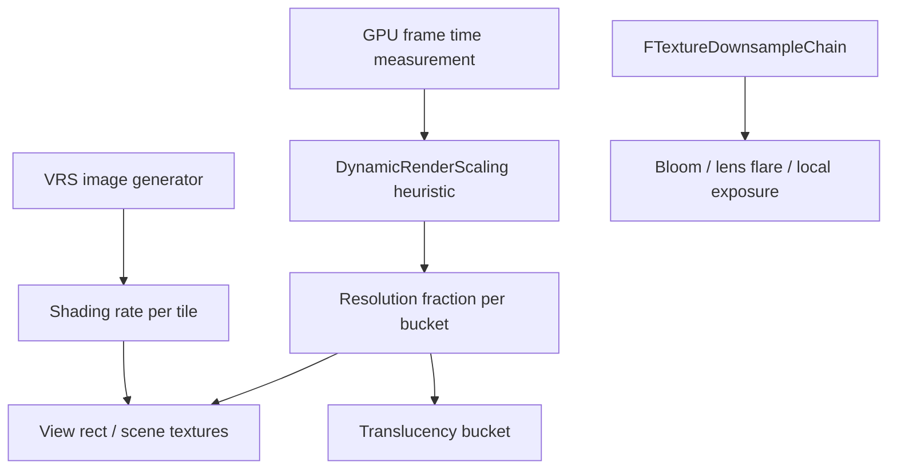

# 17 — Render Scaling, Variable Rate Shading and Performance

Three independent scaling mechanisms: a resolution fraction chosen per bucket by a heuristic, a per-tile shading rate image, and a GPU-time budget that feeds back into the heuristic. They interact only through the resolution fraction.

## Screen percentage and resolution fraction

`EPrimaryScreenPercentageMethod` (`Engine/Public/SceneView.h:136`) and `ESecondaryScreenPercentageMethod` (`:153`). Default is `SpatialUpscale` (`Engine/Private/SceneView.cpp:948`); `TemporalUpscale` is selected at `:1047` and `:1051`, and `:1147` branches on it. View-init options carry `OverridePrimaryResolutionFraction` (`SceneView.h:255`, initialised to `-1.0` at `:306`), `OverscanResolutionFraction` (`:258`), `bDisableGameScreenPercentage` (`:274`, `:309`).

Bounds: `ISceneViewFamilyScreenPercentage` (`:2272`) defines `kMinResolutionFraction = 0.01f` (`:2276`) and `kMaxResolutionFraction = 4.0f` (`:2277`) — the override interface can push resolution far below or above native. Shader-visible values: `ResolutionFractionAndInv` (`:957`) and `ViewResolutionFraction` (`:1121`) in the view uniform buffer.

## Dynamic render scaling

`DynamicRenderScaling.h`: `EHeuristicModel` (`:21`) with `Linear` and `Quadratic` branches in the implementation (`RenderCore/Private/DynamicRenderScaling.cpp:30`, `:48`, `:107` and `:34`, `:52`, `:111`). `FHeuristicSettings` (`RenderCore/Public/DynamicRenderScaling.h:33`) defaults: min fraction 0.5 (`:35`), max 1.0 (`:36`), throttling max 0.0 (`:37`), budget disabled (`:38`), change threshold 0.02 (`:39`), targeted headroom 0.05 (`:40`), increase amortization 0.9 (`:41`), `bModelScalesWithPrimaryScreenPercentage` false (`:46`). `FBudget` (`:82`) is the per-bucket state.

Asserts: `check(IsEnabled())` (`DynamicRenderScaling.cpp:23`), `check(InName)` (`:128`), `check(IsInRenderingThread())` (`:176`), `check(Budget.CachedSettings.Model != EHeuristicModel::Unknown)` (`:181`) — a bucket must have a model, so a bucket created without settings fails here.

Translucency is the main consumer (`Renderer/Private/TranslucentRendering.cpp:172`-`:181`): `Quadratic` model (`:173`), scaling basis from `CVarTranslucencyScreenPercentageBasis` (`:174`), min/max from CVars (`:175`, `:176`), `BudgetMs` (`:177`), `ChangeThreshold` (`:178`), `TargetedHeadRoom` (`:179`), `UpperBoundQuantization` (`:180`).

## Variable rate shading

`FVariableRateShadingImageManager` (`Renderer/Public/VariableRateShadingImageManager.h:30`) is a `FRenderResource` with three enums: `EVRSPassType` (`:36`), `EVRSImageType` (`:52`), `EVRSSourceType` (`:64`). CVars (`Private/VariableRateShading/VariableRateShadingImageManager.cpp`): support gate `:33`, enable `:51` with a callback that re-resolves the image type (`:40`, `:56`), software image fallback `:59`, preview `:76` (`:67`), debug force rate `:95` (`:84`), per-pass image type `:116` (`:107`).

The enable CVar has a callback (`:40`) because the software-image path (`:59`) and the hardware path produce different resource types; setting one without the other leaves a stale image.

Foveation (`FoveatedImageGenerator.cpp`): level `:19` clamped to `[0, 4]` (`:151`), dynamic foveation `:30` gated on level > 0 (`:155`), preview `:38`, gaze-tracked `:46`. Tile sanity check at `:200`: `check(GRHIVariableRateShadingImageTileMinWidth >= 8 && GRHIVariableRateShadingImageTileMinWidth <= 64 && ...)` — the generator's tile layout is only valid inside the RHI's advertised tile range. Pass event `GenerateFoveatedVRSImage` (`:239`).

Contrast-adaptive (`ContrastAdaptiveImageGenerator.cpp`): enable `:34`, edge threshold `:39`, conservative edge threshold `:44`, HDR10 correction multiplier `:49`, preview `:59`. The correction multiplier is applied only when the display is HDR10 (`:128`), scaling both thresholds (`:129`, `:130`) — the same threshold value means different things on SDR and HDR10. `check(View->bIsViewInfo)` (`:272`), `checkf(CASImageData, TEXT("FCASImageData was unexpectedly not initialized."))` (`:300`).

Nanite has its own software VRS path (`r.Nanite.SoftwareVRS`, `NaniteShading.cpp:225`) that does not go through the image manager.

## Downsample chain

`FTextureDownsampleChain` (`PostProcess/PostProcessDownsample.h:59`), `GetStageCount()` (`:95`), `FDownsamplePassInputs` (`:30`). The bloom quality enum must match the chain stage count exactly: `checkf(SceneDownsampleChain && SceneDownsampleChain->GetStageCount() == static_cast<uint32>(EBloomQuality::MAX), ...)` (`PostProcessBloomSetup.cpp:199`). Lens flares pick a stage from their own quality (`PostProcessing.cpp:1570`).

## Measurement and profiling surfaces

Event scopes and pass flags are the primary observability surface; see RDG chapter `11_Profiling_and_Insights.md`. Stats groups: `STATGROUP_RHI` (`Core/Public/Stats/GlobalStats.inl:61`), `STATGROUP_RDG` (`:62`). GPU stats are declared per subsystem, e.g. `DECLARE_GPU_STAT_NAMED_EXTERN(Postprocessing, TEXT("Postprocessing"))` (`Renderer/Private/SceneRendering.h:200`) and `CustomRenderPasses` (`:201`).

Mesh draw command budgets (`Engine/Public/MeshDrawCommandStatsSettings.h`): `FMeshDrawCommandStatsBudget` (`:12`) with `PrimitiveBudget` (`:24`) and `VertexBudget` (`:27`); totals (`:38`, `:44`, `:47`); `Budgets` (`:62`) and `BudgetTotals` (`:65`) under `r.MeshDrawCommands.Stats` (`:60`).

Critical-path stall: `CVarStallInitViews` declares the console variable `CriticalPathStall.AfterInitViews` (`DeferredShadingRenderer.cpp:1388`-`:1391`), described as "Sleep for the given time after InitViews. Time is given in ms. This is a debug option used for critical path analysis and forcing a change in the critical path." (`:1391`). Despite the name, it is applied on the render thread at `:2128`-`:2132` — immediately after the `BeginInitViews` dispatch (`:2124`) inside the `VisibilityCommands` scope (`:2123`), under `#if !UE_BUILD_SHIPPING` (`:2127`) with `SCOPE_CYCLE_COUNTER(STAT_InitViews_Intentional_Stall)` (`:2130`) — not after `EndInitViews` (`:2395`).

Async compute eligibility is decided in RDG (`RenderGraphPrivate.h:229`-`:234`): `:233` returns false when render-pass merging is enabled (`:224`-`:227`), because merging and async compute are mutually exclusive — transitions would be relocated to the ends of the merged region. Subsystems that opt in: Lumen scene lighting (`LumenSceneLighting.cpp:64`, gate `:211`), HZB (`DeferredShadingRenderer.cpp:2714`-`:2728`), Substrate classification (`Substrate.cpp:49`), MegaLights (`MegaLights.cpp:2122`, `:2127`, `:2133`), light power delta (`MegaLightsLightPowerDelta.cpp:14`, decision `:90`), local fog volume tile culling (`LocalFogVolumeRendering.cpp:55`, gate `:91`, decision `:390`), bloom (`PostProcessFFTBloom.cpp:27`-`:28`, decision `:797`), combine LUT (`PostProcessCombineLUTs.cpp:51`, decisions `:828`, `:858`). VT page requests (`VirtualTextureSystem.cpp:147`-`:152`) run on an async task, not an RDG async-compute pass.

Compute group sizing is a performance contract: `kGolden2DGroupSize = 8` (`RenderGraphUtils.h:336`), `WrappedGroupStride = 128` (`:380`) chosen because "128 appears to be the lowest common denominator" (`:376`), guarded by `check(GRHIMaxDispatchThreadGroupsPerDimension.X >= WrappedGroupStride && ...)` (`:390`). Load balancers exist because a fixed group count wastes lanes (`GPUWorkGroupLoadBalancer.h:15`, `ThreadGroupSizeLog2 = 6U` `:18`).

## Design constraints

1. Resolution fraction is bounded to `[0.01, 4.0]` (`SceneView.h:2276`, `:2277`); a bucket's own min/max (`DynamicRenderScaling.h:48`, `:49`) is a narrower window inside that.
2. A dynamic-scaling bucket must have a known model (`DynamicRenderScaling.cpp:181`).
3. Bloom quality and downsample chain stage count must match exactly (`PostProcessBloomSetup.cpp:199`).
4. Foveated VRS tile size must be inside the RHI's advertised range (`FoveatedImageGenerator.cpp:200`).
5. CAS thresholds are display-dependent (`ContrastAdaptiveImageGenerator.cpp:128`-`:130`).
6. Enabling VRS re-resolves the image type through a CVar callback (`VariableRateShadingImageManager.cpp:40`, `:56`); setting the software image separately can leave a stale resource.

## Tech artist notes

- `r.DynamicRes.*` plus per-bucket `r.DynamicRes.<Bucket>.*` is the control surface; `ChangeThreshold` (`:39`) and `IncreaseAmortizationFactor` (`:41`) exist to stop oscillation. `[INFERENCE: a budget tighter than those thresholds therefore shows up as visible resolution pumping rather than a steady lower resolution.]`
- `r.VRS.Preview` (`:76`) and `r.VRS.DebugForceRate` (`:95`) show the shading rate map without changing it; `r.CAS.Preview` (`:59`) and `r.VRS.Foveation.Preview` (`:38`) do the same for their generators.
- `r.VT.Residency.Show` (`VirtualTextureSystem.cpp:128`-`:133`) and `r.VT.CsvStats` (`:140`-`:146`) are the VT-side performance surfaces.

## Graph facts

- VariableRateShading subsystem: 78 nodes in the Renderer module; RenderCore 7,571.
- `DynamicRenderScaling` lives in RenderCore, so `TranslucentRendering.cpp` (Renderer) depends on it across a module boundary — Renderer → RenderCore is 4,633 edges.
- Highest-degree render-scope hubs: `Core/Public/IO/IoDispatcherPriority.h` 65,654, `Math/UnrealMathUtility.h` 26,349, `CoreMinimal.h` 15,081. These are not pipeline structure; they are include-graph hubs.
- Shader file counts: `Engine/Shaders/Private/Bloom/` 11, `Engine/Shaders/Private/PostProcessing/` 2. Shader files are not graph nodes.
