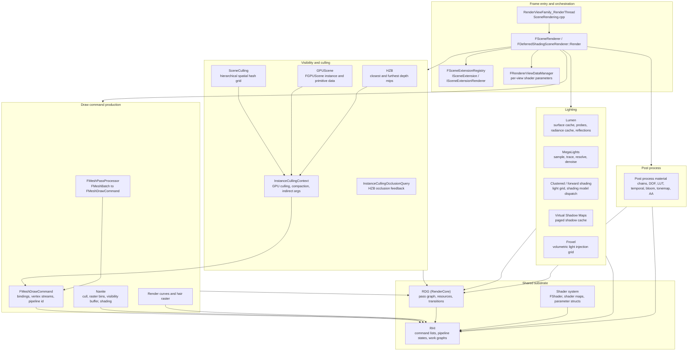
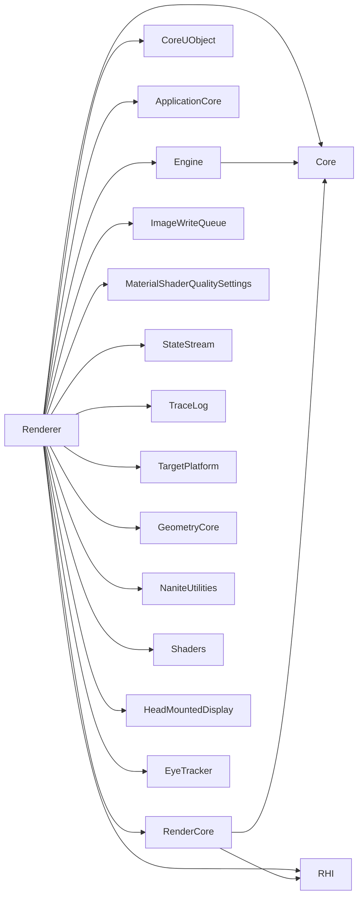

# UE 5.8 Render Pipeline — Architecture, Design and Usage

Full documentation set for every element of the Unreal Engine 5.8 render pipeline, grounded in the actual UE 5.8 source (`UE_5.8`). Each chapter covers **architecture** (types, responsibilities, key APIs, data flow), **design** (why the stage is shaped that way, constraints, budgets), and **usage** (what a tech artist must know: knobs, failure modes, cost model).

Citations are `file:line` against `UE_5.8`. Claims not observed in source are marked `[INFERENCE]`. Graph facts come from `graphify-out/graph.json` (scan root `UE_5.8`, CLI 0.9.80, 2,688,593 nodes / 5,061,968 links).

Already documented elsewhere and **not restated** here:
- RHI layer — [../RHI/](../RHI/) (access states, command lists, pipeline states, work graphs, subpasses, GPUScene basics)
- RDG layer — [../RDG/](../RDG/) (pass model, declared access, transitions, execution, profiling)

HLSL files are not nodes in the knowledge graph (`Engine/Shaders` contributes 0 nodes); shader facts in these chapters come from direct file reads, and the graph facts section is C++-only.

## Index

| File | Scope |
|---|---|
| [01_Overview_and_Architecture.md](01_Overview_and_Architecture.md) | Module map, layer boundaries, subsystem inventory, the frame contract, pipeline state commit |
| [02_Frame_Flow_and_Scene_View.md](02_Frame_Flow_and_Scene_View.md) | `RenderViewFamily_RenderThread`, `FSceneRenderer::Render`, view family/state, scene extensions, ViewData, task graph |
| [03_Instance_Culling_and_GPUScene.md](03_Instance_Culling_and_GPUScene.md) | CPU vs GPU culling decision, `FInstanceCullingContext`, load balancer, occlusion queries, indirect args |
| [04_Mesh_Passes_and_Draw_Commands.md](04_Mesh_Passes_and_Draw_Commands.md) | `FMeshPassProcessor`, `FMeshDrawCommand`, shader bindings, `EMeshPass` catalog, dispatch passes |
| [05_Pass_Catalog_and_Frame_Order.md](05_Pass_Catalog_and_Frame_Order.md) | Real per-frame pass order in `DeferredShadingRenderer::Render`, RDG event scopes, async compute islands |
| [06_Base_Pass_GBuffer_and_Shading_Models.md](06_Base_Pass_GBuffer_and_Shading_Models.md) | GBuffer layout and encoding, shading model dispatch, light grid, clustered/forward routing |
| [07_Shadows.md](07_Shadows.md) | Shadow setup, CSM, Virtual Shadow Maps, cached shadow maps, screen-space shadows, ray-traced shadows |
| [08_Nanite.md](08_Nanite.md) | Streaming, hierarchy/cluster cull, raster bins, HW/SW raster, visibility buffer, shading, feedback |
| [09_Lumen.md](09_Lumen.md) | Surface cache, mesh cards, direct lighting, radiosity, radiance cache, screen probes, reflections, denoisers |
| [10_MegaLights.md](10_MegaLights.md) | Light complexity, tile classification, sampling, ray tracing, resolve, denoise, work graph vs indirect dispatch |
| [11_Substrate.md](11_Substrate.md) | Operator/BSDF model, tiles, classification, compact representation, DBuffer, glint, budgets |
| [12_Compute_Shader_Infrastructure.md](12_Compute_Shader_Infrastructure.md) | Dispatch API, group sizing, indirect args, load balancers, prefix sums, root constants, bindless |
| [13_Screen_Space_Techniques.md](13_Screen_Space_Techniques.md) | HZB, velocity, SSR/SSRT, SSAO/GTAO, screen-space shadows, TAA/TSR, denoise framework |
| [14_Post_Process_Chain.md](14_Post_Process_Chain.md) | Actual post order: materials, DOF, LUT, temporal, motion blur, eye adaptation, bloom, tonemap, AA |
| [15_Translucency_Volumetrics_and_Water.md](15_Translucency_Volumetrics_and_Water.md) | Translucency stages, sorting, OIT, froxel/volumetric fog, SVT, heterogeneous volumes, water |
| [16_Hair_Strands_Decals_and_Virtual_Texturing.md](16_Hair_Strands_Decals_and_Virtual_Texturing.md) | Hair stages, DBuffer vs deferred decals, VT paging, material cache, skinning extension |
| [17_Render_Scaling_VRS_and_Performance.md](17_Render_Scaling_VRS_and_Performance.md) | Screen percentage, dynamic resolution heuristics, VRS sources, upscaler interface, stats |
| [18_Tech_Artist_Guide.md](18_Tech_Artist_Guide.md) | Cost model, cross-stage interactions, what breaks, debugging workflow, checklist |
| [19_File_Reference.md](19_File_Reference.md) | File inventory by subsystem with counts and responsibilities |
| [20_Testing.md](20_Testing.md) | What is actually tested, what is not, runtime validation surfaces, asserts that catch authoring errors |

## Layered architecture

## Module dependency graph (from `Engine/Source/Runtime/Renderer/Renderer.Build.cs`)

`Core` and `Engine` are public dependencies (`Renderer.Build.cs:17-22`); `CoreUObject`, `ApplicationCore`, `RenderCore`, `ImageWriteQueue`, `RHI`, `MaterialShaderQualitySettings`, `StateStream`, `TraceLog` are private (`Renderer.Build.cs:42-53`). `TargetPlatform`, `GeometryCore`, `NaniteUtilities` are added only when `Target.bBuildEditor` (`Renderer.Build.cs:24-33`) — so editor-only visualizers cannot be referenced from shipping code. `Shaders`, `HeadMountedDisplay`, `EyeTracker` are include-path/dynamically-loaded names (`Renderer.Build.cs:15, 55-58`), not link dependencies. `EngineDirectory + "/Shaders/Private"` is added as an include path so C++ can read `HaltonUtilities.ush` (`Renderer.Build.cs:9-13`).

## Source roots

| Root | Files | Contents |
|---|---|---|
| `Engine/Source/Runtime/Renderer/Private/` | 705 | Per-subsystem pass implementations |
| `Engine/Source/Runtime/Renderer/Public/` | 50 | Public interfaces: `MeshPassProcessor.h`, `ScreenPass.h`, `InstanceCulling/`, `TemporalUpscaler.h`, `VariableRateShadingImageManager.h` |
| `Engine/Shaders/Private/` | 1,146 | HLSL entry points per subsystem |
| `Engine/Shaders/Public/` | 22 | Root constants, bindless, platform includes |
| `Engine/Shaders/Shared/` | 51 | Cross-language definitions (e.g. `SubstrateDefinitions.h`) |
| `Engine/Source/Runtime/RenderCore/` | — | RDG, shader system, dynamic render scaling ([../RDG/](../RDG/)) |
| `Engine/Source/Runtime/RHI/` | — | Command lists, pipeline states, work graphs ([../RHI/](../RHI/)) |

Per-subsystem file counts (`Renderer/Private/<dir>` → `Engine/Shaders/Private/<dir>`):

| Subsystem | C++ | HLSL |
|---|---|---|
| PostProcess | 106 | 2 (`PostProcessing/`) |
| Lumen | 64 | 95 |
| Nanite | 38 | 58 |
| RayTracing | 34 | 64 |
| HairStrands | 33 | 79 |
| VT | 36 | — |
| InstanceCulling | 9 | 7 |
| VirtualShadowMaps | 9 | 37 |
| MegaLights | 12 | 32 |
| SceneCulling | 6 | 3 |
| Shadows | 13 | — |
| HeterogeneousVolumes | 9 | — |
| Skinning | 12 | — |
| Substrate | 8 | 25 |
| SparseVolumeTexture | 8 | — |
| CompositionLighting | 8 | — |
| MaterialCache | 8 | 9 |
| OIT | 3 | 1 |
| StochasticLighting | 5 | — |
| VariableRateShading | 5 | — |
| StateStream | 10 | — |
| Froxel | 4 | — |
| GPUScene (shaders) | — | 2 |
| ScreenSpaceDenoise (shaders) | — | 20 |
| SMAA / Bloom / ACES / TSR (shaders) | — | 7 / 11 / 8 / 23 |
| Tools (shaders) | — | 11 |

## Graph facts (from `graphify-out/graph.json`, scan root `UE_5.8`)

Render-scope corpus: **274,332 nodes** (nodes whose source file resolves to a rendering-relevant module).

| Module | Nodes |
|---|---|
| Engine | 109,367 |
| Developer | 88,087 |
| Core | 41,572 |
| Renderer | 22,449 |
| RenderCore | 7,571 |
| RHI | 5,286 |

Relations inside render scope: references 370,567; calls 150,141; contains 129,319; defines 109,759; imports 86,623; method 36,403; inherits 10,058.

Renderer module node counts per subsystem directory (`Renderer/{Public,Private}/<subsystem>/`):

| Subsystem | Nodes |
|---|---|
| (module root files) | 11,036 |
| Lumen | 2,220 |
| PostProcess | 1,519 |
| Nanite | 1,343 |
| VT | 970 |
| HairStrands | 915 |
| RayTracing | 788 |
| HeterogeneousVolumes | 618 |
| MegaLights | 541 |
| VirtualShadowMaps | 436 |
| SceneCulling | 315 |
| InstanceCulling | 261 |
| Skinning | 235 |
| CompositionLighting | 191 |
| Shadows | 187 |
| Substrate | 172 |
| StateStream | 154 |
| MaterialCache | 148 |
| OIT | 102 |
| StochasticLighting | 97 |
| VariableRateShading | 78 |
| SparseVolumeTexture | 77 |
| Froxel | 15 |
| Tests | 14 |

Renderer cross-module edges (directed, top): Renderer → RenderCore 4,633; Renderer → Core 4,137; → Renderer from Developer 1,320 and Editor 1,407; Renderer → CoreUObject 1,322; Renderer → Engine 1,441; Engine → Renderer 1,076; **Renderer → RHI 1,070**. The renderer's only hard low-level dependency is RHI; everything else is mediated by RenderCore.

Highest-degree render-scope files: `Core/Public/IO/IoDispatcherPriority.h` 65,654; `Core/Public/Math/UnrealMathUtility.h` 26,349; `CoreMinimal.h` 15,081; `Renderer/Private/PostProcess/PostProcessGBufferHints.cpp` 14,890; `Core/Public/Misc/Paths.h` 12,737; `Engine/Public/MaterialValueType.h` 7,196; `Engine/Private/Materials/MaterialExpressions.cpp` 6,122; `Engine/Private/Materials/HLSLMaterialTranslator.h` 5,382; `RHI/Public/RHIResources.h` 3,672; `Renderer/Private/ScenePrivate.h` 2,737.

Highest-degree Renderer files: `PostProcess/PostProcessGBufferHints.cpp` 14,890; `ScenePrivate.h` 2,737; `SceneRendering.h` 1,977; `RendererScene.cpp` 1,433; `HairStrands/HairStrandsVisibility.cpp` 1,282; `HeterogeneousVolumes/HeterogeneousVolumesVoxelGridPipeline.cpp` 1,275; `Public/MeshPassProcessor.h` 1,230; `Nanite/NaniteShared.h` 1,197; `ShadowSetup.cpp` 1,193; `Nanite/NaniteCullRaster.cpp` 1,153; `Lumen/LumenSceneData.h` 1,124; `SceneRendering.cpp` 973; `DeferredShadingRenderer.h` 946.

Most-connected symbols per subsystem (degree, file):

| Subsystem | Top symbols |
|---|---|
| Nanite | `FRayTracingManager` 125 (`Nanite/NaniteRayTracing.h`), `NaniteCullRaster.cpp` 106, `NaniteShading.cpp` 102, `FRenderer` 89, `NaniteShared.h` 87, `FPackedView` 61, `FNaniteRasterPipeline` 49 |
| Lumen | `FLumenSceneData` 161 (`Lumen/LumenSceneData.h`), `LumenScene.cpp` 82, `FLumenSceneFrameTemporaries` 73, `LumenSceneDirectLighting.cpp` 61, `FLumenCard` 53 |
| MegaLights | `FMegaLightsViewContext` 180 (`MegaLights/MegaLightsInternal.h`), `MegaLights.cpp` 85, `MegaLightsRayTracing.cpp` 59, `MegaLights::RayTraceLightSamples()` 28, `FMegaLightsViewContext::SetupStageOne()` 24 |
| Substrate | `Substrate.cpp` 69, `Substrate.h` 43, `InitialiseSubstrateFrameSceneData()` 34, `SubstrateVisualize.cpp` 32, `AddSubstrateMaterialClassificationPass()` 21, `FGlintShadingLUTsStateData` 19 |
| PostProcess | `AddPostProcessingPasses()` 103, `AddMobilePostProcessingPasses()` 86, `PostProcessEyeAdaptation.cpp` 54, `SceneRenderTargets.h` 51 |
| InstanceCulling | `FInstanceCullingContext` 104, `FInstanceCullingMergedContext` 45, `FUniformBufferStaticSlot` 31, `FInstanceCullingOcclusionQueryDeferredContext` 31, `FInstanceCullingManager` 29 |
| HairStrands | `IsHairStrandsSupported()` 118, `HairStrandsVisibility.cpp` 112, `FHairStrandsVisibilityData` 50, `FHairStrandsTiles` 48 |
| VT | `FVirtualTextureSystem` 110, `FVirtualTextureSpace` 61, `FUniqueRequestList` 52, `FTexturePagePool` 51, `FAdaptiveVirtualTexture` 46 |
| VirtualShadowMaps | `VirtualShadowMapCacheManager.cpp` 87, `VirtualShadowMapArray.cpp` 84, `FVirtualShadowMapArrayCacheManager` 81, `FVirtualShadowMapClipmap` 48 |
| RayTracing | `FRayTracingScene` 77, `RayTracing.cpp` 70, `RaytracingOptions.h` 70, `FRayTracingShaderBindingTable` 66 |
| SceneCulling | `FSceneCullingBuilder` 85, `FSceneCulling` 84, `THierarchicalSpatialHashGrid` 38, `FSceneInstanceCullingQuery` 22 |
| OIT | `OIT.cpp` 29, `FSortedIndexBuffer` 23, `FSortedTriangleData` 19, `FOITSceneData` 17 |

Shortest paths (render-scope subgraph, hub nodes included):

- `AddPostProcessingPasses()` → `FRDGBuilder` (4 hops): `AddPostProcessingPasses()` → `TryRegisterExternalTexture()` (`RenderGraphUtils.h:254`) → `RenderGraphBuilder.h` → `FRDGBuilder` (`RenderGraphBuilder.h:50`).
- `FLumenSceneData` → `FRDGBuilder` (5 hops): `FLumenSceneData` (`Lumen/Lumen.h:28`) → `Lumen.h` → `RHIShaderPlatform.h` → `RHIDefinitions.h` → `RenderGraphBuilder.h` → `FRDGBuilder`.
- `FInstanceCullingContext` → `FRDGBuilder` (3 hops): `GetStaticUniformBufferSlot()` (`InstanceCullingContext.cpp:115`) → `PlatformGPUSceneUsesUniformBufferView()` (`RenderUtils.cpp:496`) → `FRDGBuilder`.
- `FMegaLightsViewContext` → `FRDGBuilder` (4 hops): `FMegaLightsViewContext()` (`MegaLights.cpp:1282`) → `MegaLights.cpp` → `GenerateMegaLightsSamples()` (`MegaLights.cpp:2321`) → `ERDGPassFlags` (`RenderGraphBuilder.h:477`) → `FRDGBuilder`.
- `HairStrandsVisibility.cpp` → `FRDGBuilder` (3 hops): → `GpuProfilerTrace.h` → `RenderGraphBuilder.h` → `FRDGBuilder`.
- `FDeferredShadingSceneRenderer::Render` → `FRDGBuilder` (4 hops) routes through `RenderUtils.cpp` helpers, not through a direct call edge — the renderer touches RDG through utility functions, matching the RDG chapter's finding that the builder is reached through definitions and the command list.

Renderer communities (top, node count): 18 "Scene View and Materials" 2,112; 37 2,071; 6 "Render Graph (RDG)" 1,483; 33 1,360; 60 894; 156 797; 178 643; 27 393; 774 360; 310 338.
